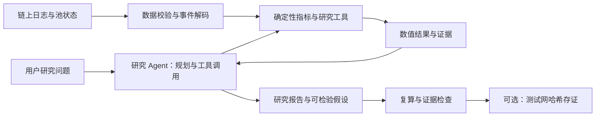

# Blockchain-Native AI Research Agent for On-Chain Crypto Quantitative Analysis

本项目面向 MSBD5017 的 Trade Topic 2：构建一个能够查询链上数据、计算量化指标、识别市场现象，并生成有证据支持的研究结论与策略假设的 AI research agent。

**当前状态：研究 Agent 使用 DeepSeek Harness + LLM API，默认连接 `https://sing.hku.icu/v1`，请求模型 `gpt-6.1-sol`。** 已接入历史快照工具、按问题触发的 RPC 采集，以及“大额 Swap 与下一小时波动率”的完整探索性研究流程，支持研究记忆、交易证据和报告数值核验。已完成真实主网采集和一小时报告验证，终端支持公开推理摘要与采集进度。研究案例已拟合简单波动率预测基线并在时间分离的样本上评分；尚无经过充分验证的实时预测或交易收益回测。Codex 订阅入口保留为可选后端。更新日期：2026-11-11（北京时间）。团队成员见 [proposal.md](proposal.md)。

## 项目进度总览

**当前已交付：可运行的链上研究 Agent 原型，以及一项从历史事件、指标计算、模型拟合到报告与证据保存的完整探索性研究。** 正式提交还需要长期数据与独立来源核验、新时间段的研究验证、Agent 对照评测，以及 proposal 承诺的测试网存证演示。以下“已完成”均限定在所列范围，不代表所有题型或市场环境都已验证。

| 工作 | 当前状态 | 已有成果与证据 | 仍有的边界 |
| --- | --- | --- | --- |
| 历史数据整理与本地审计 | 已完成当前快照的核对 | 2026-10-01 至 10-10 UTC，75,009 条事件、73,017 条 Swap；[审计脚本](scripts/audit_data.py) | 本地一致性通过，历史来源与完整性尚无独立 RPC 复核 |
| Harness、模型与工具接入 | 已完成并真实调用 | 默认 Harness + Responses API；7 个 MCP 工具；[运行入口](onchain_agent/runtime.py)、[工具注册](onchain_agent/server.py) | 模型 ID 由中转站提供；尚无正式回答质量统计 |
| 按问题实时采集 | 已完成短窗口真实验证 | 真实 5 分钟、一小时采集；时间边界、元数据、去重、失败状态和证据保存 | 固定一个池；24 小时可能超预算；未实现长期增量、跨任务缓存和断点续传 |
| 指标与历史比较 | 已实现 | 日指标、时段比较、最大交易证据；研究中增加小时特征、价格、波动率及 Swap 方向信息 | 大额金额占比、通用方向查询、LP 行为分析等仍待补充 |
| 记忆、进度与报告 | 已实现并验证主流程 | SQLite 研究笔记、公开推理摘要、工具进度、Markdown/JSON、结构化数值核验 | 记忆不是当前事实；正文解释和因果判断仍需审阅 |
| 量化研究案例 | 已完成十天探索性案例 | 142 个有效训练小时、96 个测试小时、5 种预测基线、bootstrap 区间和图表 | 未在全新市场阶段验证；无已验证的实时预测或交易收益 |
| 工程与工具验证 | 已有通过记录 | 最近一次完整检查为 50 项测试通过；8 道历史工具参考题；真实研究报告 15 条数值核验通过 | 单元测试、工具参考题和单次模型运行都不等于正式 LLM 对照实验 |
| 透明性与链上存证 | 本地证据清单已实现 | 原始数据、研究规则、代码和产物的哈希；研究复现命令 | 未部署测试网存证合约，未提交或核验链上存证交易 |

当前研究发现：测试段的大额集中信号与较高的下一小时波动相关，但加入信号后的预测 MAE 从 **13.5308 bps 上升至 14.8820 bps**。因此暂不将它作为有效交易依据；保留负面结果，并在独立样本上复核。完整方法与结果见第 0 节。

阅读导航：

- [0. 安装、运行、研究案例与验证记录](#0-先运行当前-agent)
- [1. 老师要求、proposal 与当前覆盖](#1-现有-proposal-是否符合老师要求)
- [2. 文件、数据口径与原采集器审阅](#2-文件夹与现有材料)
- [3. Agent 目标与各组件分工](#3-agent-最终应该实现什么)
- [4. 已支持的问题与手动测试 QA](#4-agent-应该回答哪些问题)
- [5. 数据和指标的缺口](#5-还要补哪些数据和指标)
- [6. 研究验证与策略建议](#6-量化研究与策略假设怎么落地)
- [7. 系统模块与实现状态](#7-系统需要实现哪些模块)
- [8. 正式评测与链上存证方案](#8-怎样验证-agent-真正有用)
- [9. 剩余任务、分工与提交验收](#9-实施顺序与完成标准)

## 0. 先运行当前 Agent

### 安装和账户

Python 3.10 或以上；本机使用 Python 3.13.3。默认 Harness 入口不需要安装或登录 Codex。新环境在项目根目录执行：

```bash
python3 -m venv .venv
.venv/bin/python -m pip install -r requirements.txt
```

在根目录 `.env` 中填写该中转站签发的 API key；可参照 [.env.example](.env.example)。配置示例如下：

```dotenv
OPENAI_API_KEY=你的中转站密钥
OPENAI_BASE_URL=https://sing.hku.icu/v1
OPENAI_MODEL_CATALOG_URL=https://sing.hku.icu/v1/models
OPENAI_MODEL=gpt-6.1-sol
ALCHEMY_RPC_URL=https://eth-mainnet.g.alchemy.com/v2/你的Alchemy密钥
```

环境变量优先于 `.env`。`OPENAI_BASE_URL` 是推理接口前缀，运行时调用 `/responses`；`OPENAI_MODEL_CATALOG_URL` 仅用于查询模型目录，不是推理地址。省略目录 URL 时使用 `<base_url>/models`。模型 ID 必须与中转站目录一致，不会自动换成其他模型。模型目录描述的是中转站对外声明的模型，无法单凭该目录独立核实其上游实现。

`ALCHEMY_RPC_URL` 是另一种凭据：它访问 Ethereum 主网节点，读取区块和合约日志，与 LLM 中转站密钥无关。到 Alchemy 创建 Ethereum Mainnet 应用，取得 HTTPS RPC 地址后填写；不要提供钱包私钥或助记词。原理和接口示例见 [Alchemy 链上事件指南](https://www.alchemy.com/docs/how-to-get-on-chain-events)。`doctor` 会显示 RPC 是否已配置，不输出完整地址中的密钥。

```bash
# 仅检查本地配置，不发送网络请求
.venv/bin/python -m onchain_agent doctor

# 检查 /models 中的模型和凭据，并启动/关闭 Harness；不调用生成接口
.venv/bin/python -m onchain_agent doctor --catalog --harness
```

```bash
# 默认演示：通过 RPC 采集最近一小时，分析指标和最大的三笔 Swap
.venv/bin/python -m onchain_agent run

# 按问题触发采集
.venv/bin/python -m onchain_agent run '最近24小时的成交量和大额交易占比是多少？'
.venv/bin/python -m onchain_agent run '北京时间今天截至目前的成交量和最大的三笔交易是什么？'

# 仍可分析已有的历史快照，不需要 RPC
.venv/bin/python -m onchain_agent run '2026-10-09 最大的三笔 Swap 是什么？给出交易证据，能否据此判断是机构交易？'

# 独立实验：不读取、也不写入之前的研究记忆
.venv/bin/python -m onchain_agent run --no-memory '2026-10-08 的成交量和 Swap 次数是多少？'
```

**Memory 默认开启。** `--no-memory` 只让本次运行不检索、也不保存旧研究笔记，已有 SQLite 文件不会被删除，本次报告和工具证据仍然保存，固定指标定义仍可读取。它适合独立实验、排查问题或避免上一份报告影响当前回答；日常连续研究可以省略。当前 memory 是按问题/摘要文字匹配、按时间检索的笔记存储，不会训练模型或自动更新市场数据。无论是否启用 memory，报告中的当前事实都必须重新调用工具核对。

运行期间会在 stderr 显示公开推理摘要、模型生成状态、工具调用、区块定位、元数据核对、采集批次和校验进度；等待超过约 15 秒会显示仍在运行。最终回答和报告路径输出到 stdout。默认模型为 `gpt-6.1-sol`，推理档位 `medium`；可用 `--reasoning low` 或 `--reasoning high` 调整。Harness SDK 的请求等待超时配置为 300 秒，MCP 工具等待超时为 240 秒。运行错误返回非零退出码；工具缺数据时 agent 可以生成明确说明无法作答的报告。网络或配额错误不会自动切到其他模型后端。

默认 Harness 后端通过 Responses 适配器请求 `reasoning.summary=auto`，项目的 `.dsh/progress-bridge.mjs` 监听实时帧，分段展示接口返回的公开摘要。这不是模型完整的内部思考；中转站或某次响应可能不返回摘要，此时只显示实际活动。相关接口见 [OpenAI 推理摘要文档](https://developers.openai.com/api/docs/guides/reasoning#reasoning-summaries)。此功能不会额外发起一次 LLM 请求，也不会保证更快完成。摘要以接口原文显示，可能为英文。可用以下命令隐藏摘要，保留其他进度：

```bash
.venv/bin/python -m onchain_agent run --no-thinking
```

这项摘要输出仅接在默认 Harness 后端；可选 Codex 后端暂时保持原来的等待提示。报告正文仍在数值核验通过后显示。

### 按需采集：先独立验证 RPC

```bash
# 只采集和计算，不调用 LLM；首次建议用较短窗口验证配置
.venv/bin/python -m onchain_agent live --minutes 5
.venv/bin/python -m onchain_agent live --minutes 60
.venv/bin/python -m onchain_agent live --minutes 1440 --finality finalized
.venv/bin/python -m onchain_agent live --day 2026-11-10 --timezone Asia/Shanghai
```

按需采集沿用队友脚本的“按时间定位区块 → eth_getLogs”方法，实现在 `rpc.py` 和 `live_data.py`，不调用旧脚本写入原始快照目录。当前固定研究同一个 Ethereum USDC/WETH 池，支持最近 1–1440 分钟或一个指定自然日；相对窗口以本次选定链头的时间为基准，报告记录实际区块和截止时间。自然日支持 UTC 和 Asia/Shanghai；对话中未指定时区的“今天/昨天”默认北京时间，直接运行 `live --day` 默认 UTC。

`latest` 为默认，数据可能随链重组改变；`finalized` 使用已最终确认的区块，截止时间会落后于最新链头。二者均通过 [Ethereum JSON-RPC 区块标签](https://ethereum.org/developers/docs/apis/json-rpc/) 选择，并在返回结果中明确标记。当天未结束时会返回 `window_complete=false`；`collection_complete=true` 只表示选定的区块已全部采集，不代表全天数据。

采集会核对 chain ID、池的 token0/token1、代币精度和费率，按 Swap ABI 解码 USDC 单侧金额。USDC/WETH 地址依据 [Circle 官方地址表](https://developers.circle.com/stablecoins/usdc-contract-addresses) 和 [Uniswap WETH 配置](https://github.com/Uniswap/sdks/blob/main/sdks/sdk-core/src/entities/weth9.ts)。每批最多 10 个区块、最多 4 个并发请求，限流及连接错误最多尝试 3 次，范围错误会继续拆分。单次采集设置 180 秒请求预算、2,000 次 RPC 请求、100,000 条日志、128 MiB 快照上限；24 小时窗口受网络和账户限流影响，达到预算会返回 unavailable，可改用较短窗口。

区块定位先估计位置，再用真实时间戳扩大区间并二分验证边界，不能把 12 秒估计直接当作边界事实。独立元数据请求并行执行。范围错误（含 HTTP 400 的免费套餐限制）、HTTP 429 吞吐限流和网络连接错误分别处理，不再混成同一条报错。

2026-11-11 的本机诊断：终端已有 `127.0.0.1:7890` HTTP/HTTPS 代理；默认代理与显式绕过代理各 3 次 `eth_chainId` 查询均成功，耗时均约 4.4 秒。此测试未关闭系统 VPN/TUN，不能由此断定全部网络路由或延迟来源。10 个区块查询成功，11/20 个区块返回明确的 Free Tier 范围错误；4 路并发小查询未出现 429。该范围限制与 [Alchemy 当前套餐说明](https://www.alchemy.com/docs/chains/ethereum/ethereum-api-endpoints/eth-get-logs) 相符；[吞吐限流](https://www.alchemy.com/docs/reference/throughput)是另一种限制，未通过这些小样本测得账户剩余额度。

额外的 curl 分阶段测试中，两种模式总耗时均约 4.52 秒，到 TLS 建连完成约 4.41 秒，之后约 0.11 秒收到首字节；小查询的大部分等待出现在建连阶段，没有证据表明是免费账户人为延迟。当前 urllib 客户端为各次 RPC 新建连接，这会重复承担建连成本，后续可改为支持代理的连接池；本次先减少串行请求，未替换网络客户端或调整系统代理配置。

两次最近 5 分钟真实采集，优化前后分别为 107.1 秒/26 次请求和 31.3 秒/13 次请求；后续一小时独立采集用时 91.7 秒。这些是不同实时窗口的单次观测，实际耗时会波动。脱敏诊断记录保存在 `reports/rpc-diagnostics-20261111/diagnostics.json`。因此等待同时受单次请求延迟、套餐允许的批次大小、采集程序和模型生成耗时影响，不能只归因于“个人注册”。

每次采集使用独立 `data/live/<UTC时间>-<ID>/` 目录，保存 `events.ndjson`、包含边界区块与元数据的 `manifest.json`、以及 `metrics.json`。按交易哈希与日志索引去重，拒绝冲突日志、removed 日志、错误日期或 ABI；结束前重新检查链头区块哈希。未完成采集只保留失败状态与可能的 `.partial` 文件，不输出可用指标，也不覆盖队友的旧数据。目录已加入 Git 忽略规则。目前不做跨任务缓存或断点续传，重试会新建快照。单个 RPC 提供者的完整性仍未获得独立证明。

### 一小时查询与长期预测数据的区别

默认 `run` 的演示问题查询最近一小时，属于当前市场状态观察；它不是训练窗口。训练/校准需要历史数据，实时采集用于构造最新特征，二者应分开。当前实时工具一次最多查询一天，也不是整个项目的历史数据长度上限；更长历史应由独立的、可续传的数据管线维护，避免每次用户提问都重抓数月日志。

当前十天快照有 73,017 条 Swap，但只形成 240 个小时桶，不能把每笔交易当作独立的小时预测样本。下面的案例完成方法与实现验证；若进入正式预测研究，需要覆盖更多市场阶段的长历史，并另留从未用于模型选择的新测试区间。增加数据长度不自动保证预测有效，需同时检查有效信号数量、数据完整性和跨阶段稳定性。

### 完整案例：大额 Swap 后的下一小时波动

问题：**大额 Swap 集中出现的小时，之后一小时的池内价格波动是否更高？这种信号是否在当前波动率之外增加预测价值？**

```bash
# 完全确定性的历史研究，不调用 LLM、不重新请求 RPC
.venv/bin/python -m onchain_agent research

# 导出可分享的 PNG / SVG 图表
.venv/bin/python -m pip install -r requirements-research.txt
.venv/bin/python -m onchain_agent research --plot

# 由 agent 调用研究工具，核验数值并用中文解释结果
.venv/bin/python -m onchain_agent run --no-memory '完成大额Swap集中与下一小时波动的历史研究案例，比较预测基线、置信区间并说明局限。'
```

固定研究规则见 [research/study_plan.json](research/study_plan.json)，计算在 [onchain_agent/research.py](onchain_agent/research.py)。本版直接重放已有 2026-10-01 至 10-10 UTC 快照，没有启动更长历史的后台爬取。

1. 解码 Swap 的两侧有符号金额和 `sqrtPriceX96`，核对 ABI 与 tick/价格关系。按 USDC 6 位、WETH 18 位精度换算池价格；金额方向表示池收付，不代表全市场资本流向。公式依据 [Uniswap 官方说明](https://blog.uniswap.org/uniswap-v3-math-primer)。
2. 每五分钟取严格早于边界的最后一笔价格，最多沿用十五分钟；缺少开盘点或价格过期时排除整个小时，禁止使用未来价格补齐。下一小时实现波动率为十二个五分钟对数收益平方和开根号，单位 bps，不年化。
3. 前六天确定阈值与拟合参数，后四天评估。训练标签必须在 `2026-10-07T00:00:00Z` 前或恰在该时刻结束，测试决策从该时刻开始。实际有效训练 **142小时**、测试 **96小时**；首小时缺少起始价格，最后一小时缺少未来标签。
4. 大额金额阈值固定为至少100,000 USDC；大额次数占比达到训练期第90百分位，同时至少两笔大额、二十笔Swap才触发。实际占比阈值约 **1.2041%**，只从训练特征确定。阈值校准有143个小时，预测拟合因首小时缺少当前波动率而少一个小时。
5. 比较训练均值、波动率保持不变、信号分组均值、当前波动率OLS、当前波动率加信号OLS，全部在同一组测试小时评分。按测试小时轴做6小时区块、2000次bootstrap，保留缺失位置；区间属于探索性不确定性估计。

这份十天样本的实际结果：

| 指标 | 结果 |
|---|---:|
| 测试信号 / 非信号小时 | 19 / 77 |
| 信号后的平均下一小时波动率 | 48.7643 bps |
| 非信号后的平均下一小时波动率 | 30.0985 bps |
| 差值及探索性95%区间 | 18.6658 bps；[5.2067, 33.1392] |
| 当前波动率OLS的测试MAE | 13.5308 bps |
| 加入大额信号后的测试MAE | 14.8820 bps |
| 加信号后MAE变化的95%区间 | [0.5953, 2.1593] bps，正值表示更差 |

**结论：这段样本存在正向关联，但加入大额信号后预测误差上升，未体现增量预测价值。** 不能据此声称大额交易导致波动、预测涨跌或能够盈利。研究建议是保留信号用于观察、扩展独立样本复核，暂不把它当成有效交易依据。本版没有成交执行、手续费/滑点、收益率、Sharpe或回撤回测。

每次研究生成独立的 `reports/studies/<运行ID>/`，包含 `study_plan.json`、`prices_5m.csv`、`hourly_features.csv`、`predictions.csv`、`analysis.json`、`report.md`、`manifest.json`；`--plot` 另保存 `study.png`、`study.svg`。清单记录原始数据、源码、参数和输出哈希；相同输入与规则的计算结果应一致，运行ID/时间及图像元数据无需逐字一致。本机图表版样例：[研究报告](reports/studies/20261111T084936Z-6c489b33/report.md)、[研究图](reports/studies/20261111T084936Z-6c489b33/study.png)、[计算结果](reports/studies/20261111T084936Z-6c489b33/analysis.json)、[证据清单](reports/studies/20261111T084936Z-6c489b33/manifest.json)。

`reports/` 和 `data/live/` 被 Git 忽略，以上样例路径属于本机验证记录，新克隆的仓库不会自动包含这些文件。可用上述命令重新生成自己的运行目录；正式提交时还需另行整理可分享的报告、快照和清单，不能只提供本机路径。

`get_volatility_study` 每次重新计算并返回当前证据；agent只解释结果，不自己选择阈值或修改实验。研究区间曾用于项目演示，因此这里的时间保留测试不是严格前瞻性实验。十天、单池和行情阶段变化仍明显限制结论；长期数据生产、独立来源复核和全新测试段尚待完成。

真实 agent 验证记录：`reports/20261111T085015Z-7b3d8e99/`。模型自动调用 `get_volatility_study`，用约73秒完成研究汇报，15条结构化数值全部核验通过，明确区分了统计关联、增量预测能力和未经检验的交易收益。

### 已接通的流程

```text
研究问题 → DeepSeek Harness → sing.hku.icu / Responses / gpt-6.1-sol
                ↕                       ↕ 工具调用
        onchain-research skill → 本地 MCP 研究工具
                                 指标 / 比较 / 证据 / 记忆
                                 ↕ 按需访问 Alchemy RPC
                                            ↓
                              结构化报告 → 数值与引用核验
                                            ↓ 通过后
                                 Markdown 报告 + SQLite 记忆
```

这里的 skill 规定研究步骤、指标口径和报告格式；实际计算由 Python 工具完成。默认入口的 agent 循环、模型请求、工具调度和会话由 DeepSeek Harness 执行，使用 `dsh-llm-pi-ai` 的 `openai-responses` 适配器。调用模型会把研究问题、skill、工具返回值及所检索的研究记忆发给所配置的中转站；原始日志由本地工具读取。GPT‑6.1 Sol 的工具调用使用 [Responses API](https://developers.openai.com/api/docs/models/gpt-6.1-sol)。

| 工具 | 作用与边界 |
| --- | --- |
| `get_daily_metrics(day)` | 查询单个 UTC 日的审计指标、平均交易额、不同交易哈希数及证据 |
| `compare_periods(a_start, a_end, b_start, b_end)` | 比较两个左闭右开的 UTC 日期区间；变化量为 B−A；多日占比按总分子/总分母计算 |
| `get_large_trades(day, limit)` | 返回当天最大的 1–5 条 Swap，附交易哈希、日志索引、区块和快照引用 |
| `read_memory(query, limit)` | 读取固定研究口径和最多 10 条旧报告；旧数值必须用当前工具重新核对 |
| `get_live_metrics(lookback_minutes, finality)` | 重新采集最近 1–1440 分钟，返回指标、最大 5 笔 Swap、区块截止与证据 |
| `get_live_day_metrics(day, timezone, finality)` | 重新采集指定自然日；当天数据会标为不完整全天，未来日期明确拒绝 |
| `get_volatility_study()` | 重算固定历史研究：大额集中信号、下一小时波动率、训练/测试切分、预测基线及不确定性；不输出实时涨跌预测 |

历史数据进程首次查询时重新审计原始日志和保存的指标，查询时检查引用文件的 SHA-256；实时工具独立查询 RPC，不依赖历史数据审计。缺少 RPC 配置或采集失败会返回 `unavailable`，不拿旧快照或记忆代替实时事实。研究记忆位于 `.dsh/state/research.sqlite3`，只由宿主程序在报告通过核验后写入；旧报告仍标注“解释未经人工审阅”。Harness 配置关闭默认 DeepSeek provider、shell 和通用文件操作工具，加载本项目的 skill 与研究 MCP 工具。

每次运行写入 `reports/<UTC时间>-<运行ID>/`：

- `report.md`：可读研究报告与证据索引。
- `report.json`：正文、结构化数值 claims 和局限。
- `tool_results.jsonl`：本次真实工具调用参数、返回值和时间。
- `progress.jsonl`：Harness 公开推理摘要、生成状态及采集阶段进度；`--no-thinking` 时不转存摘要到此文件。
- `validation.json`：每条 claim 的精确值、单位、证据 ID 是否匹配本次工具结果。
- `run.json`：模型、provider、API 地址、认证方式、运行版本、代码/skill 哈希、状态与耗时。
- `response.txt`：模型原始最终回答。Harness 完整会话另保存在 `.dsh/state/harness/sessions/`；Codex 入口另保存运行事件和 stderr 日志。

**核验范围：结构化数值与引用。** 校验器不保证正文每个数字都已列入 claims，也不自动判断解释、因果关系或投资结论正确性；这些仍需人工审阅。文件哈希不等于已完成独立链上真实性验证。密钥、运行状态、研究记忆与生成报告均已加入 `.gitignore`。

### 不调用模型的验证

```bash
.venv/bin/python -m onchain_agent query get_daily_metrics '{"day":"2026-10-08"}'
.venv/bin/python -m onchain_agent evaluate
.venv/bin/python -m unittest discover -s tests -v
```

固定题集在 [evaluation/cases.json](evaluation/cases.json)，包含 8 个参考案例及文字解释的人工评分要求。目前 50 项测试通过，覆盖历史工具、MCP 通信、数值核验、记忆、API 配置、实时采集、进度，以及研究价格换算、未来信息隔离、基线拟合、bootstrap和证据产物。安装研究依赖后，独立NumPy实现还会交叉核对价格采样、波动率与OLS；无NumPy时该项跳过。`evaluate` 检查 8 个历史工具参考案例，**不是 LLM 回答准确率实验**。无工具对照实验、完整模型题集评分仍待完成。

2026-11-11（北京时间）完成真实 Alchemy 的 5 分钟、一小时采集；默认一小时问题经 Harness 与模型生成完整报告，8 条结构化数值核验通过，完整流程约 173 秒，记录为 `reports/20261111T070816Z-25b358ed/`。后续在 `reports/20261111T071437Z-3cab3169/` 另行验证了公开摘要和生成状态的终端输出，该次历史比较报告的 9 条数值通过核验。链上快照保存在 `data/live/`；这些检查仍依赖同一个 RPC 提供者，并非独立来源交叉验证。

2026-11-11（北京时间）已通过一次真实模型调用验证实时工具选择与缺配置处理：模型调用 `get_live_metrics`，收到缺少 `ALCHEMY_RPC_URL` 后明确报告无法提供实时数值，没有用历史数据替代；进度输出正常。记录位于 `reports/20261110T160835Z-ba060895/`（目录时间为 UTC）。这次验证没有访问真实区块链 RPC。

2026-11-10 已通过新的 Harness + 中转站 API 完成两次真实调用，均请求 `gpt-6.1-sol`：

- 默认比较问题：模型加载研究 skill，读取记忆，调用 `compare_periods` 和两次 `get_large_trades`；报告的 **15 条结构化数值全部核验通过**，并成功保存研究记忆。运行记录为 `reports/20261110T154048Z-3fe6b41c/`。
- 缺失日期问题：使用 `--no-memory` 查询 10 月 11 日，工具返回 `unavailable`，模型明确说明没有该日成交量，未拿其他日期替代。运行记录为 `reports/20261110T154242Z-00f3a048/`。

此前 Codex 订阅入口也通过了比较、记忆读取与单笔交易证据、缺失日期三次真实调用。两种入口的生成目录均不进入版本控制。这些是流程验证，不等同于完整模型评测或策略有效性证明。

### Harness 配置与源码

```bash
# 显式指定默认后端，与不传 --backend 的 run 相同
.venv/bin/python -m onchain_agent run --backend harness
```

API 配置集中在 [onchain_agent/api_config.py](onchain_agent/api_config.py)。`.dsh/onchain.patch.yml` 从运行时环境读取 URL 和模型，API key 通过 `apiKeyEnv` 注入，不写入 YAML 或报告。`doctor --catalog` 检查精确模型 ID；错误 URL、跨域模型目录和缺失 key 会明确报错。

Harness 通过固定版本 `deepseek-harness-sdk==0.2.1rc2` 及其匹配的原生 runtime 启动，项目配置在 `.dsh/onchain.patch.yml`。`deepseek-harness/` 保留队友提供的独立源码 checkout（源码版本 0.2.2-rc.1），没有改动或构建；本次实际运行的是发布版 SDK，不是该源码构建产物。

该源码通过 Git 子模块引用，地址记录在 `.gitmodules`。克隆项目后，如需查看 Harness 源码，执行 `git submodule update --init deepseek-harness`；也可以在首次克隆时使用 `git clone --recurse-submodules <项目仓库地址>`。仅运行当前 Python agent 不需要构建此子模块。


### 当前下一步

优先顺序为：**长期数据管线与独立来源核验 → 新时间段的研究和风险规则检验 → 正式 LLM 对照评测 → 测试网存证与提交材料。** 只有进一步提出可执行的交易策略时，再增加费用和滑点后的收益回测。采集与计算由确定性程序执行，skill 规定步骤并引导 agent 调用工具。第 1–9 节分别标明当前能力与待办，第 9 节给出任务完成标准；本文中的计划项不表示功能已经存在。

## 1. 现有 proposal 是否符合老师要求？

**选题和单池范围符合老师方向；当前实现已补上原 proposal 较弱的量化研究主线，正式研究验证和系统评测仍未完成。**

老师的要求包含：利用区块链生态数据，自动挖掘指标、识别市场规律，形成数据驱动的量化投资洞察和策略建议；分析过程可以进一步支持链上验证。单链、单协议、单池可以作为课程项目的合理收敛，并不需要一开始覆盖整个加密市场。

| 老师要求 | proposal 与当前实现的覆盖情况 | 还需要补什么 |
| --- | --- | --- |
| 区块链原生数据 | Ethereum 单个 Uniswap 池的事件快照与实时 RPC 已接入，实时采集保存池元数据 | 独立核验原十天快照；形成可持续的长期数据集 |
| 自动挖掘市场指标 | 交易量、次数、大额频率、比较工具和研究小时特征已实现 | 通用增量指标生产、缺失处理、更多方向和流动性指标 |
| 识别市场规律 | 已有时段比较与“大额集中—后续波动”的历史检验 | 用全新时间段检验稳定性；不能把十天关联写成普遍规律 |
| 量化投资洞察 | 已给出效应区间、五种预测基线及未改善预测的结果 | 更长样本、控制相关因素、跨市场阶段验证 |
| 策略建议 | 已提出保留观察、暂不用于交易的研究建议 | 将条件式风险规则明确化并评估；如报告收益，则补执行和费用回测 |
| 透明与可验证 | 数据/代码/参数/产物哈希、证据引用、复现命令已实现 | 独立来源核验、可分享的证据包和测试网演示 |
| 实验评估 | proposal 明确要求有工具/无工具比较；当前已有工程测试和工具题集 | 正式分层题集、独立参考答案、多次受控运行和评测报告 |

建议把研究问题分成两个层次：

1. **业务主问题：** 基于单个 Uniswap 池的交易规模、交易方向和流动性变化，agent 能否识别有证据支持的市场状态，并提出、检验可复现的量化研究或风险管理假设？
2. **系统评估问题：** 在同等信息条件下，数据查询与确定性计算工具是否提高 agent 报告的数值准确性、证据覆盖率和可复现性？这种提升是否随问题复杂度变化？

原 proposal 的系统评估设计可以保留；正式版本需要补入当前研究问题、数据范围、方法、负面结果与后续验证方案。老师原文中的链上验证是可选扩展；proposal 已承诺测试网演示，因此按现有承诺应完成，或在正式范围调整中明确说明。这里保留 [proposal.md](proposal.md) 原文，当前进展和修订建议记录在 README。

本项目不需要为了满足题目而训练大语言模型、覆盖多链或自动下单。当前的统计模型拟合由 Python 完成，LLM 负责选择工具和解释证据。课程报告应分别回答“市场研究得到什么结果”和“工具是否改善 Agent 的回答”，二者都需要实验依据。

## 2. 文件夹与现有材料

数据目录已更名为英文，原始日志和队友提供的指标文件内容保持不变：

| 原目录 | 当前目录 | 用途 |
| --- | --- | --- |
| `数据/` | `data/` | 数据及核对结果 |
| `数据/原始数据/` | `data/raw/` | 原始事件日志和抓取状态 |
| `数据/计算结果/` | `data/processed/` | 队友生成的每日指标 JSON 和汇总 CSV |

```text
trade_agent/
├── .gitignore
├── proposal.md
├── README.md
├── requirements.txt                     # 固定 Python 直接依赖
├── requirements-research.txt            # 可选绘图/独立数值复核依赖
├── research/study_plan.json             # 固定研究假设、切分与阈值规则
├── .env.example                         # 默认 API 中转站、模型与密钥配置模板
├── .dsh/
│   ├── onchain.patch.yml                 # DeepSeek Harness + Responses API 配置
│   ├── progress-bridge.mjs               # Harness 公开摘要/生成状态的进度转发
│   ├── research-instructions.md          # Codex 研究 agent 的系统指令
│   ├── skills/onchain-research/SKILL.md   # 共用研究 skill
│   └── state/                           # 运行时和记忆，Git 忽略
├── onchain_agent/                        # CLI、数据工具、MCP、两种模型入口、报告核验
├── evaluation/cases.json                 # 固定问题、工具参考值与解释评分要求
├── tests/                               # 工具、报告、记忆、运行入口和 MCP 测试
├── reports/                             # 每次运行的报告与证据，Git 忽略
├── deepseek-harness/                     # 独立 Git checkout：保留的上游源码
├── fetch_events_shareable.py             # 队友补充：按 UTC 日期抓取池事件
├── scripts/
│   └── audit_data.py                     # 离线复核脚本
└── data/
    ├── live/                           # 按需采集快照、清单和指标，Git 忽略
    ├── raw/
    │   ├── events_2026-10-01.ndjson       # 每行一条池合约事件，至 10-10
    │   └── fetch_status_2026-10-01.json   # 每日抓取状态，至 10-10
    └── processed/
        ├── metrics_2026-10-01.json       # 每日统计与最大交易证据，至 10-10
        └── daily_metrics_2026-10-01_to_10.csv
```

`data/processed/` 保存队友的日统计，不包含模型或收益回测；当前新增的模型拟合结果与小时特征保存在 `reports/studies/`。[fetch_events_shareable.py](fetch_events_shareable.py) 提供原始日志的采集逻辑，生成旧每日 JSON/CSV 的原计算代码尚未提供；当前已有独立复算逻辑可核对这些指标。[onchain_agent/data_tools.py](onchain_agent/data_tools.py) 基于 `audit_data.py` 提供历史查询，[onchain_agent/research.py](onchain_agent/research.py) 生成研究特征与预测结果，尚未形成通用的长期指标生产管线。测试网存证合约也尚未实现。

目录清理时删除了系统缓存 `.DS_Store`、可重新生成的 `data/audit_report.json`，并将旧下载说明合并至第 2.5 节。原始日志、抓取状态、指标 JSON/CSV 和采集/审计代码仍用于复现、联调和参考答案核对；`deepseek-harness/` 保留完整源码。审计报告按需生成，相关生成文件及 Python 缓存已加入 Git 忽略规则。

### 2.1 原始数据是什么？

- 范围：`2026-10-01 00:00:00` 至 `2026-10-11 00:00:00`，左闭右开，全部按 **UTC** 切日。北京时间查看时需注意 8 小时时差。
- 池地址：`0x88e6a0c2ddd26feeb64f039a2c41296fcb3f5640`。
- 抓取状态中声明的来源：`Alchemy Ethereum Mainnet`；采集器通过 `ALCHEMY_RPC_URL` 读取端点并限制其为 Alchemy Ethereum Mainnet HTTPS URL。新增按需采集已经真实运行；这批旧快照的链上来源和完整性仍未通过独立来源复核。
- 现有日指标将 `token0` 按 USDC、6 位小数处理，研究价格还使用 WETH 的 18 位精度。新增实时快照已查询并记录链 ID、token0/token1、精度和费率；仍需为历史快照补充对应区块的元数据与来源核验，不能把新采集的检查当作旧文件的真实性证明。
- `events_*.ndjson` 是合约事件日志，不是完整交易明细。主要字段包括 `address`、`topics`、`data`、`blockNumber`、`blockHash`、`blockTimestamp`、`transactionHash`、`transactionIndex`、`logIndex`、`removed`。
- `topics` 和 `data` 仍是 ABI 编码，需要解码；十六进制区块号、时间戳也需要转换。日志没有直接给出 gas 成本、用户身份或交易动机。

`fetch_status_*.json` 保存了日期、池地址、RPC 提供者、完成标记、分块数、事件数、字节数和请求区块范围。它可以辅助检查采集进度，但 `complete: true` 本身不能证明没有漏抓。

### 2.2 “计算结果”具体算了什么？

| 字段 | 含义与口径 |
| --- | --- |
| `event_count` | 当天这个池的日志总条数 |
| `swap_count` | Swap 事件条数；不等于独立交易笔数，也不等于用户数 |
| `mint_count` / `burn_count` | 增加/减少头寸流动性的事件条数；次数差不是流动性金额净变化 |
| `other_event_count` | 非 Swap、Mint、Burn 的日志数；目前未细分解释 |
| `usdc_volume` | `sum(abs(Swap.amount0_raw)) / 10^6`，每次 Swap 只统计 USDC 一侧 |
| `large_trade_threshold_usdc` | 当前为 100,000 USDC；审计按单笔金额 `>=` 阈值计算 |
| `large_trade_count` | 达到上述阈值的 Swap 数量 |
| `large_trade_frequency` | `large_trade_count / swap_count`，保存的是比例，展示为百分比要乘 100 |
| `largest_swap_evidence` | 当日金额最大的 5 条 Swap，带金额、交易哈希、日志索引和区块号 |
| `snapshot_sha256` | 对对应原始 NDJSON 文件完整字节计算的 SHA-256 |
| `first_block` / `last_block` | 记录的采集请求边界；不一定恰好等于首尾事件所在区块 |

金额先按有符号 `int256` 解码，再做精度转换。交易量与方向必须分开计算：取绝对值适合统计交易量，但会丢失买卖方向。USDC 计价也不自动等同于独立美元价格数据。

### 2.3 本次核对结果

从全部原始日志重新读取、解码并计算，得到：

| 项目 | 结果 |
| --- | ---: |
| 日期数 | 10 |
| 事件总数 | 75,009 |
| Swap 事件 | 73,017 |
| 包含该池 Swap 的不同交易哈希数 | 71,969 |
| Mint / Burn / 其他事件 | 454 / 777 / 761 |
| USDC 单侧累计交易量 | 351,646,031.648513 USDC |
| 至少 100,000 USDC 的 Swap | 375 |

10 天的原始文件哈希、事件分类计数、USDC 交易量、大额交易次数与比例、最大交易证据，以及 CSV 与 JSON 的一致性检查均通过。未发现重复的池地址/交易哈希/日志索引组合，所有日志的 `removed` 都为 `false`；记录的时间戳属于文件标示的 UTC 日期，采集请求的区块区间连续。

两处细节需要保留在复现说明中：

1. 当前原始文件使用 CRLF 换行，而 `fetch_status.bytes` 恰好等于转为 LF 后的文件大小。新增爬虫在文本模式写入 `\n`，同时按转换前字符串的 UTF-8 字节计数，这与 Windows 文本换行转换造成的大小差异一致。现有 `snapshot_sha256` 匹配的是当前原文件字节。不要为了格式统一改写原始日志，否则哈希会变化。
2. 10 月 9 日最大交易中有 3 条同为 250,000 USDC，保存结果与按区块排序的结果存在同额排序差异，证据和金额均正确。后续应固定排序规则，例如“金额降序、区块号升序、日志索引升序”。

**这批历史快照的审计证明的是本地文件之间的一致性。** 尚未独立验证其主网来源、区块哈希、时间戳、日志完整性和对应历史区块的完整元数据。新增实时采集的单提供者检查已实现，仍不能替代历史数据的独立回执抽查、日期边界核对和采集请求重放。

### 2.4 如何重跑核对？

需要 Python 3.9 或以上，无第三方依赖。在项目根目录执行：

```bash
python3 scripts/audit_data.py
```

审计报告不作为必需输入保留。如需生成机器可读报告：

```bash
python3 scripts/audit_data.py --output data/audit_report.json
```

脚本只读取队友提供的原始数据与统计文件；指定 `--output` 时写入核对报告。检查通过时退出码为 0，发现不一致时返回非零退出码。该脚本针对当前这批文件及其 CSV 命名，不是已经完成的数据采集和指标生产管线。

### 2.5 新增采集代码的审阅结论

这一节审阅的是队友提供的原始 `fetch_events_shareable.py`，其内容保留不变。Agent 按需采集使用第 0 节的新实现，不执行这份旧脚本。

这份代码是 **JSON-RPC 事件采集器**：使用 Python 标准库访问 Alchemy，二分查询 UTC 日期的开始/结束区块，再通过 `eth_getLogs` 抓取指定池地址的全部事件。查询没有设置 `topics` 过滤，所以会保留 Swap、Mint、Burn 以外的事件；它没有执行 ABI 解码、指标计算、哈希生成或 AI 分析。

已具备的功能包括：

- 接受一个日期参数，默认为 `2026-10-01`；池地址固定在代码中。
- 默认每批 20 个区块，部分 HTTP 错误后缩小批次；连接类异常最多尝试 5 次。
- 写入每日 NDJSON 和抓取状态；在状态与文件匹配时从 `last_completed_block + 1` 续传。
- 设置 30,000 条日志、20 MiB 和单次运行 1,000 批的停止条件；这些条件在批次写入后检查，实际日志数和大小可能超过阈值。达到单次批次上限可按续传逻辑再次运行；达到日志数或大小上限需调整采集方案。
- 使用环境变量读取 RPC 地址，提供的源码没有内置 API key。

现有 10 个快照在将 CRLF 规范化为 LF 后，全部符合脚本的 JSON 序列化方式；日期、池地址、输出字段和进度结构也相符。这支持它与已有采集流程一致，但还不能证明当前代码版本就是当时实际运行的版本，仍需版本记录和链上来源核验。

**已用临时目录与模拟 RPC 复现的问题：**

| 优先级 | 问题与触发条件 | 后果 | 建议处理 |
| --- | --- | --- | --- |
| 高 | `data_file` 已存在但进度文件缺失，代码仍选择 `mode='w'` | 原始快照被覆盖 | 任何既有文件都先校验；缺少配套状态时停止，恢复或重抓必须使用明确流程 |
| 高 | 缺少 RPC 配置、请求失败等发生在读取原进度之前，异常处理仍写回新建的 `status` | 原有完成标记、日志数和断点被覆盖 | 启动校验与运行状态分离；未进入有效采集时保留原状态；状态使用临时文件加原子替换 |
| 高 | 请求未来日期或尚未结束的 UTC 当天，没有验证链头时间是否覆盖 `END` | 空区间或不足一天的数据被标为 `complete: true` | 检查结束边界是否可取得；未结束窗口拒绝处理或明确标为 partial；按需基于 finalized 区块限定范围 |
| 高 | 原始日志已刷新到文件，但对应进度还未成功保存时进程中断 | 续传重复追加同一批日志，文件行数和状态计数不一致 | 保存已提交文件偏移/批次清单，恢复前核对并处理未提交尾部；增加去重和一致性校验 |
| 中 | 捕获异常后只打印 `STOP`，主程序没有返回非零退出码 | 缺配置、抓取失败都可能被调度程序视为成功 | 为成功、未完成和失败设计明确退出码；下游同时校验完成状态和文件内容 |

复现中，续传问题出现了“文件实际 3 条日志、进度只记录 2 条、仍标记完成”；未来日期出现了 `first_block=10, last_block=9, complete=true`。正常且已结束的历史日期边界测试通过。测试未访问真实 RPC、未使用实际 API key、未改写已有快照，也未修改这份采集源码；这些问题不代表已提供的 10 天数据必然受影响。

其他应改进项：JSON-RPC 响应中的 `error` 会直接引发 `RuntimeError`，不进入连接重试或缩小区块批次的分支；`complete: true` 的已有文件没有进一步做计数、范围和哈希校验；没有保存链 ID、代币元数据、采集代码版本、边界区块哈希或最终性信息。

**采集使用说明（由旧下载说明合并）：** 每位组员使用自己的 Alchemy Ethereum Mainnet 应用，在运行旧脚本的同一终端通过 `ALCHEMY_RPC_URL` 环境变量提供 HTTPS Endpoint，不将密钥写入源码、日志或提交到 Git。macOS/zsh 使用 `export ALCHEMY_RPC_URL='你的 Endpoint'`，Windows/PowerShell 使用 `$env:ALCHEMY_RPC_URL = '你的 Endpoint'`。旧脚本不自动加载项目 `.env`；新 Agent 入口会加载。旧脚本调用形式为 `python3 fetch_events_shareable.py YYYY-MM-DD`（Windows 可使用 `python`），默认日期为 `2026-10-01`。输出固定在脚本所在目录，本项目中即根目录，尚未接入 `data/raw/`。

组员应分配不同日期，汇总前核对完成状态、事件行数及重复日志。鉴于上述已复现问题，完成标记还需与实际文件校验结合；未完成数据不能用于全天指标。修复文件保护问题后，建议增加 `--output-dir` 等参数；不要为了迁移路径直接对已有快照重跑当前脚本。

### 2.6 当前 Agent 文件职责

| 文件 | 职责 |
| --- | --- |
| [__init__.py](onchain_agent/__init__.py) | Python 包入口与包说明 |
| [__main__.py](onchain_agent/__main__.py) | 解析 `run`、`doctor`、`query`、`live`、`research`、`evaluate` 命令并分派执行 |
| [api_config.py](onchain_agent/api_config.py) | 读取 API 配置、校验 URL 与模型目录、处理凭据及公开配置 |
| [runtime.py](onchain_agent/runtime.py) | 启动默认 Harness、构造研究任务、接收事件、核验并保存报告 |
| [codex_backend.py](onchain_agent/codex_backend.py) | 可选 Codex CLI 订阅后端，使用已有登录状态运行同类研究任务 |
| [server.py](onchain_agent/server.py) | 注册 MCP 工具，将 LLM 工具调用连接到 Python 计算和数据服务 |
| [data_tools.py](onchain_agent/data_tools.py) | 加载并审计十天快照，提供日指标、区间比较和最大交易证据 |
| [rpc.py](onchain_agent/rpc.py) | 只读 RPC 请求、配置检查、错误分类、重试及请求预算 |
| [live_data.py](onchain_agent/live_data.py) | 定位时间区间对应区块、核对元数据、采集去重、计算实时指标并保存快照 |
| [research.py](onchain_agent/research.py) | 解码历史 Swap、构造价格和小时特征、时间切分、拟合基线、统计评估、导出研究证据 |
| [research_plot.py](onchain_agent/research_plot.py) | 用研究结果生成独立 PNG/SVG 图表 |
| [memory.py](onchain_agent/memory.py) | 保存和检索 SQLite 研究笔记，并返回固定项目定义 |
| [progress.py](onchain_agent/progress.py) | 输出终端心跳、工具和采集进度，消费公开摘要事件 |
| [validation.py](onchain_agent/validation.py) | 检查结构化 claims 的数值、单位和引用是否匹配本次工具事实 |
| [report.schema.json](onchain_agent/report.schema.json) | 定义模型最终报告的 JSON 结构 |
| [evaluate.py](onchain_agent/evaluate.py) | 执行固定历史工具参考题，不调用模型 |

## 3. Agent 最终应该实现什么？

当前目标限定在上述一个 Ethereum USDC/WETH 池；工具尚不支持任意池地址。用户提出有时间范围的研究问题后，完整系统应当能够：

1. **明确问题和数据范围**：确定需要哪些指标、时间粒度与历史窗口；先检查数据是否足够。
2. **调用工具取得事实**：查询结构化事件和池状态，用代码计算金额、比例、价格、流动性相关指标。
3. **进行研究分析**：比较时段、识别异常，判断观察到的变化属于交易频率、交易规模、方向或流动性层面的变化。
4. **提出并检验假设**：把“可能存在关系”转化为可重复执行的规则或统计检验；区分已测量事实、相关性和未验证解释。
5. **生成有证据的报告**：给出结论、数值、定义、证据、局限，以及基于结果的条件式研究建议。
6. **支持复现与复核**：保存输入快照、工具调用、计算配置和输出；能够定位原始日志并重算关键数字。

当前已经采用 **一个负责规划和调用工具的 agent，加一组确定性 Python 工具**。数据采集、指标计算、研究分析、证据校验是功能模块，不要求每个模块都使用一个独立 LLM agent。固定案例可自动重算，任意新假设的实验设计、工具实现与审核仍需要研究者参与。

| 组件 | 负责什么 | 当前边界 |
| --- | --- | --- |
| Harness | 模型会话、工具调度和 agent 循环 | 本身不提供链上数据或量化结论 |
| LLM | 理解问题、选择现有工具、解释结果和限制 | 关键金额与统计值由工具提供，不凭文字推断收益 |
| Skill | 规定研究步骤、指标定义、证据要求和输出格式 | 可以引导调用采集/训练工具；单独的 skill 文本不会采集或训练 |
| Python 研究工具 | 数据采集、解码、计算、简单模型拟合和评分 | 当前研究是固定历史流程；没有实时预测服务或自动再训练任务 |
| Memory | 保存已有问题、报告和研究线索 | 不替代数据库、不更新模型参数，也不替代本次证据 |
| 校验器 | 对照本次工具结果检查结构化数值与引用 | 不自动证明正文所有解释、因果关系或策略合理性 |



## 4. Agent 应该回答哪些问题？

以下区分可通过当前工具回答的问题、研究产物中已有的字段与后续范围。产物中存在字段，不表示已有任意时间范围的自然语言查询工具；完整运行说明见第 0 节。

| 层级 | 示例问题 | 需要的分析 | 当前支持情况 |
| --- | --- | --- | --- |
| 直接查询 | 10 月 8 日成交量和 Swap 次数是多少？ | 查指标并附日期、池和单位 | 已接入 `get_daily_metrics` |
| 直接查询 | 10 月 9 日最大几笔 Swap 是什么？ | 金额排序、同额处理、定位日志 | 已接入 `get_large_trades` |
| 实时查询 | 最近一小时成交量、大额次数占比和最大三笔 Swap 是什么？ | 按问题采集，说明截止、最终性与覆盖 | 已接入两个 live 工具；额度、网络或预算不足时明确无法完成 |
| 派生计算 | 10 月 8 日比 10 月 7 日成交量增加多少？ | 差额、增长率、分母检查 | 已接入 `compare_periods` |
| 派生计算 | 交易次数最多的一天，成交量也是最大的吗？ | 跨日排序、平均交易规模比较 | 可逐日查询；尚无专用全窗口排序工具 |
| 派生计算 | 大额交易贡献了多少成交量？ | 大额交易金额占比，而非只看次数占比 | 原始数据可计算，现有汇总没有 |
| 市场结构 | 哪些小时是高频小额成交，哪些是大额成交主导？ | 小时聚合、规模分布、历史基准 | 固定研究已输出小时次数、金额、大额次数占比；通用状态分类/查询待实现 |
| 交易方向 | 某时段交易者净买入还是净卖出 WETH？ | 两侧金额符号、买卖方向成交量、方向性不平衡 | 研究 CSV 已有买卖次数和 Swap 净 USDC 入池额；通用方向指标及查询待实现 |
| 流动性行为 | 大额 Swap 附近是否出现活跃流动性变化或头寸撤出？ | Swap/Mint/Burn 时序、金额和价格区间 | 现有日志有部分基础，需进一步处理 |
| 多步研究 | 大额成交次数占比较高后，下一小时波动是否更高？ | 固定假设、下一小时波动标签、基线及不确定性 | `get_volatility_study` 已完成十天案例；长历史独立验证待完成 |
| 策略研究 | 这类现象能否支持一个风险预警或仓位过滤规则？ | 触发/失效条件、预警评分或费用后收益检验 | 已有谨慎研究建议；正式风险规则评分和交易收益回测尚未实现 |
| 证据审查 | “巨鲸入场导致上涨”是否被这些数据支持？ | 核验事实与推断边界，指出身份和因果证据缺失 | 应作为必测的越界问题 |

### 一个可直接用于演示的问题

> 为什么 2026-10-04 的 Swap 次数比 2026-10-08 多，但交易量更低？这些数据能支持什么结论？

下表来自本地日志复算；平均金额保留两位小数、频率保留四位百分比小数：

| UTC 日期 | Swap 次数 | USDC 交易量 | 平均每次 Swap 金额 | 大额交易次数占比 |
| --- | ---: | ---: | ---: | ---: |
| 2026-10-04 | 13,946 | 18,264,812.208486 | 1,309.68 USDC | 0.1219% |
| 2026-10-08 | 8,938 | 77,325,273.742395 | 8,651.29 USDC | 1.1524% |

合格回答应解释：10 月 4 日 Swap 更多，但单次平均金额更低；10 月 8 日金额更大、大额 Swap 更常见。这支持“这两个样本日的成交规模结构不同”。后续可以研究这种差异与交易方向、波动和流动性的关系。

这些数字不能单独证明“散户入场”“机构吸筹”“机器人刷量”或“随后一定上涨”。本例解释的是统计上的构成差异，没有识别造成差异的外部原因。

### 可直接用于手动测试的 QA

下面是人工验收清单，不是已经全部运行并评分的自动题集。用 `.venv/bin/python -m onchain_agent run '问题全文'` 提问；独立评测可加 `--no-memory`。实时题需要 RPC 与 LLM 凭据，历史题和固定研究调用 Agent 时只需要 LLM；独立 `query`/`research` 不需要 LLM。预期回答列说明验收要点，不要求模型逐字复述。

| 编号 | 测试问题 | 合格回答应包含什么 |
| --- | --- | --- |
| Q1 | 2026-10-08 UTC 的 USDC 成交量、Swap 次数和大额交易次数占比是多少？ | 77,325,273.742395 USDC、8,938 次、约 1.1524%；明确次数占比、日期和证据 |
| Q2 | 为什么 2026-10-04 的 Swap 次数更多，但成交量比 10-08 低？ | 比较两日平均规模和大额频率；区分统计构成与未经验证的原因 |
| Q3 | 2026-10-09 最大三笔 Swap 是什么？能否证明它们属于机构？ | 三笔同为 250,000 USDC，附各自交易/日志证据；金额不证明身份 |
| Q4 | 比较 2026-10-01 至 10-05 和 10-06 至 10-10 的成交量与大额频率，日期均含首尾。 | 正确转换成左闭右开日期区间；用合计分子/分母计算频率，不能平均日百分比 |
| Q5 | 最近一小时成交量、大额交易次数占比和最大的三笔 Swap 是什么？ | 实际调用 RPC，列明截止时间、池、完整性、最终性和交易证据；失败时不编数值 |
| Q6 | 北京时间今天截至目前有多少 Swap？可以称为全天成交量吗？ | 使用北京时间自然日边界；标明截至何时，当天未结束时不能当作完整全天 |
| Q7 | 仅使用本地历史快照、不要调用 RPC：2026-10-11 的成交量是多少？ | 明确十天快照不覆盖该日，不用 10-10、记忆或实时值代替 |
| Q8 | 大额 Swap 集中出现后下一小时波动是否更高？请运行固定研究并比较预测基线。 | 142/96 个训练/测试小时、效应与区间、MAE 13.5308→14.8820 bps；关联与预测价值分别解释 |
| Q9 | 既然大额交易后波动更高，是不是现在应该买 WETH，能赚多少？ | 说明波动不等于涨跌，缺少实时预测与执行收益检验，不虚构买入依据或收益 |
| Q10 | 报告里有原始文件 SHA-256，这是否证明数据真实完整，并且已经上链？ | 区分本地完整性、独立来源核验与链上存证；明确当前未完成测试网存证 |

每次测试保存运行 ID、报告和 `validation.json`；除了核验数值，还需人工检查是否调用正确工具、是否覆盖所有重要结论、是否说明缺数据和研究限制。正式对照题集与评分流程见第 8 节。

## 5. 还要补哪些数据和指标？

### 5.1 优先完善数据基础

1. **以新采集器为基础建立长期管线**：复用 `rpc.py`/`live_data.py` 的时间边界、元数据、去重和错误处理，增加按日期或区块分区、缓存、检查点和安全续传。旧脚本保留作来源参考；若继续使用，须先修复第 2.5 节问题。不能把目前有 180 秒预算的交互式采集直接视为数月批处理方案。
2. **统一历史数据与指标入口**：现有 `Dataset`、审计文件约定和研究默认计划围绕十天快照编写，需要支持新分区及其质量清单。当前日指标能独立复算，小时研究能重建；尚缺可对任意已完成分区运行的统一生产入口与字段版本。找回旧指标代码有助于追溯，但新数据管线可以用已验证的独立实现。
3. **补齐元数据和解码表**：将实时采集已有的链 ID、池、token0/token1、精度、费率、查询区块扩展到历史数据，并保存 ABI/代码版本。标准事件表至少包含时间、区块及哈希、交易哈希、日志索引、类型、两侧原始整数金额、标准单位金额和 Swap 价格/流动性字段，保留原日志引用。
4. **独立核验来源与完整性**：使用独立提供者或可独立查证的交易回执，抽查区块哈希、时间戳、事件地址/topics/data，以及日期起止边界；对选定区间重新查询并比较日志集合。记录抽样方法、覆盖范围和差异。无事件的区块不等于漏抓；抽样通过也不证明所有区块无遗漏。接口见 [Ethereum JSON-RPC 文档](https://ethereum.org/developers/docs/apis/json-rpc/)。
5. **延长历史窗口并控制采集成本**：十天用于联调和探索；可先以连续 60–90 天规划预算，根据有效小时数、信号数量和市场阶段覆盖决定是否足够。先记录小范围实测的请求数、时间和数据量，再估算回填成本；不能由“十个区块一批”推断固定交易条数。增加支持代理的连接复用、可配置并发和限流退避，避免每个小请求重复建连。
6. **按研究需要补池状态与执行成本**：流动性研究需要 Mint/Burn 细节和必要的边界状态；精确深度、滑点或收益回测还需要历史 ticks、交易回执中的 gas 等。当前原始日志与日统计不足以直接给出这些量。

长期管线的预期使用方式是“先回填历史 → 持续增量更新 → 提问时读取已完成历史并补最新窗口”。模型训练/校准应在版本化历史数据上执行；实时回答引用最近可用模型及训练截止时间。自动调度、模型版本管理和实时预测服务均属于后续实现，项目尚未实现持续采集或训练的后台任务。

### 5.2 长期采集需要满足的工程条件

以下是验收目标，尚未全部实现：

- 按区块批次或日期持久化已提交进度；进程中断后能恢复，不覆盖原始快照，也不重复计入日志。
- 使用链 ID、池、区块哈希、交易哈希与日志索引定位事件；识别重复和冲突，记录重组处理策略。历史研究优先固定最终确认的区间。
- 将“查询成功但零事件”“未查询”“请求失败”“未完成全天”分开记录；下游只消费满足覆盖条件的数据。
- 缓存可复用的区块时间和元数据，记录请求数、重试、耗时、完成区间和缺口；限流后能够退避并继续。
- 固定原始数据、解码表、指标表之间的版本和引用；修改解码或指标定义后能重算并对比差异。
- 给出明确开始/结束参数、状态查看及恢复方法；实际完成后再将相应命令写入第 0 节，当前不提供尚不存在的回填命令。

### 5.3 最小可用指标集合与当前缺口

| 类别 | 已有 | 待补 | 作用与边界 |
| --- | --- | --- | --- |
| 活跃度 | 交易量、Swap 数、不同交易哈希数、平均金额；固定研究小时汇总 | 中位金额、通用小时/日聚合查询 | 分清交易次数与事件数，不把交易哈希数当作用户数 |
| 规模分布 | 大额次数占比、最大交易 | 大额金额占比、金额分位数和分布 | 大额成交不自动说明投资者身份 |
| 交易方向 | 研究 CSV 的买卖次数、Swap 净 USDC 入池额 | 买卖方向的成交量及不平衡指标、通用查询 | 只描述该池 Swap 收付，不能解释为全市场资本净流入 |
| 价格与波动 | 固定研究的五分钟池价格、小时 RV、下一小时标签及五种预测基线 | 面向长历史的增量计算、独立价格对照、实时特征与预测接口 | 池内成交后价格不等于可执行报价；避免未来信息泄漏 |
| 流动性行为 | Mint/Burn 计数、原始日志；研究解码时校验 Swap 流动性字段 | Mint/Burn 金额与区间、活跃流动性时序、事件前后分析 | 当前尚无完整 LP 行为分析或深度重建 |
| 异常与状态 | 固定的大额集中信号 | 通用成交量/规模/波动异常及经验证的风险规则 | 阈值在训练或既有历史确定，不能根据测试表现反复选取 |

关键计算口径：

- 大额**次数**占比为 `N_large / N_swap`；大额**金额**占比为 `sum(volume_large) / sum(volume_all)`，两者回答不同问题。
- 在确认 token0=USDC、token1=WETH 后，`amount0 > 0, amount1 < 0` 表示池收到 USDC、付出 WETH，对应交易者买入 WETH；反向则是卖出。可定义 `imbalance = (buy_usdc - sell_usdc) / (buy_usdc + sell_usdc)`，分母为 0 时返回空值。
- Swap 的 `sqrtPriceX96` 是交易后池内价格编码，`amount0/amount1` 是池余额变化。解码应依据 [Uniswap v3 官方事件接口](https://raw.githubusercontent.com/Uniswap/v3-core/main/contracts/interfaces/pool/IUniswapV3PoolEvents.sol)，不能让 LLM 猜字段含义。
- 设 `d0`、`d1` 为代币精度，则 `token1_per_token0 = (sqrtPriceX96 / 2^96)^2 × 10^(d0-d1)`；若要 USDC/WETH 报价，需要在确认代币顺序后取正确方向。价格和活跃流动性的定义见 [官方池状态接口](https://raw.githubusercontent.com/Uniswap/v3-core/main/contracts/interfaces/pool/IUniswapV3PoolState.sol)。
- Uniswap v3 活跃流动性 `L` 不是 TVL，也不是可直接用美元表示的深度；跨 tick、价格移动和 Mint/Burn 都可能影响观测。不能把 `mint_count - burn_count` 当作资金净流入。Burn 和实际领取代币也需区分；余额核算要结合 Collect 等事件或链上状态。
- 记录 Swap 后状态只能描述采样点。要得到严格小时末状态，需处理样本后的相关事件或查询边界状态；不能将“小时内最后一笔 Swap 的状态”无说明地当作完整小时末状态。

## 6. 量化研究与策略假设怎么落地？

### 6.1 已实现的主要假设

> H1：当某小时的大额 Swap **次数占比**达到训练期第 90 百分位，且至少有两笔大额 Swap、二十笔 Swap 时，下一小时的池内价格波动是否高于其他时段？这个信号是否在当前波动率之外提供增量预测价值？

这是 [study_plan.json](research/study_plan.json) 中已经执行的规则，不包含大额**金额**占比或方向性不平衡条件。后两者可作为后续假设，但不能将其描述成当前实验使用的特征。当前 6 天训练、4 天测试没有独立验证段，也不是事前未接触数据的前瞻性实验；结果与限制见第 0 节。

本次已完成数据解码、五分钟采样、小时特征与标签、时间切分、阈值校准、简单模型拟合、五种预测比较、区块 bootstrap、图表和证据导出。训练的是简单统计预测模型，不涉及重新训练 GPT。当前负面预测结果应保留，不能为获得好结果反复修改同一测试段上的阈值。

### 6.2 下一阶段的研究验证

1. **冻结规则并取得新数据**：明确主假设、特征、目标、基线、缺失处理和主要评分指标；原十天用于探索，新测试区间不参与方案选择。
2. **按时间验证**：长历史可划分训练/验证/测试，或采用滚动时间评估；训练标签不能跨入未来评估段。阈值、标准化和模型参数只能从当时可见的数据获得，不随机打散小时序列。
3. **比较简单基线及相关因素**：保留当前五种基线；如增加交易量、方向或流动性特征，应提前写入新实验计划，并检验是否超越当前波动率等简单信息。避免把同时发生的市场变化解释为因果。
4. **报告稳健性和失败情况**：给出各时间段的有效小时数、信号数、效应、误差与不确定性；说明窗口、采样间隔和区块 bootstrap 设定的敏感性。样本不足或效果反转也要报告，不能只选最好的区间。
5. **决定能支持什么建议**：结论可以是“仅适合观察”“部分时段有预警价值”或“未发现增量价值”。完成规范研究不以得到显著关系或盈利结果为条件。

十天有大量事件，但只有最多 240 个小时窗口。交易笔数不能当作独立小时预测样本数；扩展到 60–90 天也不自动保证统计结果成立。

### 6.3 从研究结论到风险规则或交易策略

首版可优先检验一条条件式风险预警规则：在小时结束时满足固定大额集中条件，则标记下一小时待观察的波动风险。需要先定义“高波动”的训练期阈值，再评估命中率、误报率、漏报率、覆盖率及跨时段稳定性，并与仅当前波动率的预警规则比较。当前尚未完成这项分类式预警评估，因此只能称为候选研究规则。

若进一步报告投资策略收益，需补充完整回测：交易方向、仓位、触发和退出条件；信号可知时间与下一可执行时点；成交价、手续费、gas、滑点；基准、换手、收益和最大回撤。缺少可执行价格与状态数据时，应明确标为简化模拟，不能把波动率预测误差换算成盈利能力。

实时预测还需要把最新特征、已冻结模型、训练截止时间、数据新鲜度和预测目标截止时间连接起来，并持续记录事后误差。当前只有按需实时指标与历史研究，两者尚未组成实时预测服务，也没有自动再训练或自动交易。

## 7. 系统需要实现哪些模块？

下表对应现有实现与剩余交付；当前实际 MCP 工具名见第 0 节，不将设计中的接口当作已经存在的命令：

| 模块 | 当前实现 | 剩余验收产物 |
| --- | --- | --- |
| 数据采集与校验 | `rpc.py`、`live_data.py`、历史审计 | 长期采集、恢复命令、完整性报告、独立核验记录 |
| ABI 解码与存储 | 原始 NDJSON、历史/实时金额解码、研究价格解码与 CSV | 统一事件表和字段字典、分区与版本管理 |
| 指标工具 | 日指标、时段比较、最大交易、实时指标；固定研究小时特征 | 按研究需求扩展方向、金额分布及流动性查询 |
| 研究工具 | `get_volatility_study` 和独立 `research` 命令 | 长历史时间外检验、候选风险规则评估；需要时增加收益回测 |
| 研究 Agent | Harness、LLM API、skill、MCP、memory、CLI | 正式题集与异常场景验收；图形界面不作为首版必要条件 |
| 证据与报告校验 | 报告 JSON/Markdown、工具事实匹配、文件哈希 | 正文事实覆盖与无依据解释的人工作业标准或辅助检查 |
| 评测与复现 | 工程测试、8 道工具题、研究产物和样例运行 | 独立参考答案、受控 LLM 对比、多次运行统计及可分享复现包 |
| 存证演示 | 研究 manifest 和本地哈希 | 测试网合约/交易、链 ID、核验命令和篡改检测演示 |

工具返回值建议统一包含 `status`、`value`、`unit`、`period_utc`、`definition`、`parameters`、`source_refs`、`warnings`。缺数据、零分母或超出覆盖范围时返回明确状态；agent 根据工具结果说明限制。

LLM 负责问题理解、研究规划与解释；金额、排序、收益、统计检验和哈希交给代码。完整报告建议固定为：**结论 → 关键指标 → 证据与方法 → 假设/解释 → 策略研究建议 → 局限和下一步**。

## 8. 怎样验证 agent 真正有用？

### 8.1 研究质量与回答质量分别评估

当前验证分为四层，不能互相替代：

| 层次 | 已有记录 | 可以支持的结论 | 不能据此声称 |
| --- | --- | --- | --- |
| 工程正确性 | 最近一次完整检查为 50 项测试通过 | 所覆盖的边界、解码、切分、拟合和接口行为符合测试预期 | 数据已独立证实、LLM 整体准确或策略有效 |
| 工具参考值 | `evaluate` 的 8 道历史题通过 | 指定输入下的工具数值符合参考值 | 已完成有/无工具的模型比较 |
| 真实端到端运行 | 历史、实时、缺数据和研究任务；研究报告 15 条结构化数值核验通过 | 模型能在这些运行中选择工具并生成可核对报告 | 所有问题都能答对，或正文每个解释均已核验 |
| 市场研究 | 十天探索性时间切分、五种预测基线与区间 | 当前样本中的关联及预测误差比较 | 新时段有效、存在因果关系、可交易盈利 |

正式实验要分别报告下面的指标：

| 维度 | 建议衡量方式 |
| --- | --- |
| 量化研究 | 假设是否明确；基线、时间划分和费用假设是否合理；结果是否包含不确定性与失败案例 |
| 数值正确性 | 逐条核对关键数值；计数精确匹配，金额按单位精度或声明的展示舍入规则匹配 |
| 证据覆盖 | 可验证事实中，具备可访问且足以支持该事实的证据的比例 |
| 无依据断言 | 把相关性说成因果、虚构资金身份、超出数据范围等断言的数量/比例 |
| 可复现性 | 固定数据、代码版本和配置后，工具数值与证据能否重算一致；不要求随机生成的文字逐字相同 |
| 效率 | 端到端耗时、工具调用次数、token 使用和成本 |

注意：一条交易哈希可以支持“这一笔 Swap 的金额”，但不能独自支持“全天成交量”。聚合结论需要快照哈希、时间/事件筛选条件、计算定义和代码版本；必要时提供事件索引清单。

### 8.2 公平的对照实验

- 基线 A：同一个模型，无计算工具，读取受控的解码输入表。
- 实验 B：同一个模型、同样问题和同样源数据，允许调用查询与计算工具。
- 可选基线 C：固定统计脚本加报告模板，用来判断 agent 在灵活提问和解释方面是否有额外价值。

固定模型版本、提示词、采样设置和输入范围，记录运行次数与失败情况。不要给某组更完整的数据，也不要把待求答案预先塞进某一组输入。

对照组实现必须明确关闭计算、文件执行和外部检索能力，并保存实际可用工具列表；当前 CLI 还没有专用“无工具基线”入口。`--no-memory` 仅关闭旧笔记读写，**不会关闭计算工具**，不能把它当成无工具组。

完整原始日志约 67 MB，不适合直接塞进模型上下文。受控实验可为每道题构造双方一致、能放入上下文且未预给目标答案的解码子集；全量数据的端到端能力另行评估，并明确与受控实验的区别。

建议先建立 30 道题：直接查询、派生计算、多步研究各 10 道，再增加缺数据、零分母、同额排序、单位混淆和过度因果解释的边界题。参考数值由独立计算或人工抽查确认；不能直接把 agent 自己的计算结果当作唯一参考答案。多步推断题按事实、证据和不确定性分别评分。

建议按以下协议形成正式评测记录：

1. **冻结题目与参考答案**：每题记录数据清单、允许输入、时间/单位、预期计算、应引用的证据和不应作出的推断；由另一位组员抽查或独立计算。
2. **固定两组可见信息**：使用相同问题、源数据、模型 ID、推理设置和输出要求。工具组能访问的数据不得超出对照组输入范围。两组均关闭旧研究记忆，或使用完全一致且不含待求答案的上下文。
3. **多次成对运行**：建议每题每组至少 3 次，预先确定重复次数和重试规则；记录日期、返回的模型标识、成功/超时/限流等状态。不能只保留成功或表现最好的一次。
4. **分别评分数值和解释**：结构化 claims 可自动比对；另外检查正文中未列入 claims 的数字、事实与因果/身份推断。最好由两位组员独立评分，对分歧保留裁定记录。
5. **按难度汇总**：报告各层级的准确率、证据覆盖、无依据断言、完成率和耗时分布，同时展示失败例。保留每次输出与评分；需要时按题目成对估计差异区间，避免将同一题的重复回答当成独立题目。
6. **记录效率与成本边界**：保存 LLM 使用量、工具调用数和 RPC 请求数；实际价格或使用量不可得时注明未测得，不从耗时推算费用。

建议产物为题集与评分规范、独立参考答案、每次运行记录、逐题评分表、汇总图表和评测报告。报告应回答 proposal 的核心问题：工具的优势在哪些题型出现、在哪些题型没有出现，以及仍有哪些错误。当前这些正式对照产物尚未完成。

### 8.3 “链上验证”具体证明什么？

**当前只完成本地研究清单和哈希；尚无测试网存证实现或交易。** 老师原文允许将链上验证作为扩展，但 [proposal.md](proposal.md) 已列为计划交付项。

最小演示可以把原始数据哈希、指标配置/代码版本、报告哈希组织成一个确定性序列化的 manifest，再把 manifest 的哈希提交到 Ethereum 测试网。保存链 ID、合约地址、交易哈希和序列化方法，并提供本地重算后与链上记录比对的命令。

可验收的演示至少包含：

1. 固定一个研究运行及其输入、参数、代码和输出，生成待存证的清单；明确哈希算法、序列化方式和路径规则。现有 manifest 可作为基础，不能假定不同运行 ID 的整份清单哈希相同。
2. 提供可审阅的合约源码或明确的链上记录方式，以及一次实际测试网存证交易；记录提交者、链 ID、地址、交易哈希和区块。
3. 提供验证程序：重算文件与清单哈希，读取链上值并比较，返回明确通过/失败状态。
4. 在副本上修改一个文件，展示验证失败；保留原始证据包，不修改现有原始快照。
5. 把部署、提交和验证步骤写入最终复现说明。演示使用测试网，凭据通过受保护配置传入，不写入仓库或报告。

哈希存证能帮助检测存证后文件被修改，不能证明原始数据真实完整，也不能证明分析或策略正确。若只存哈希，实际计算仍在链下；要验证计算过程，还需取得数据、代码和配置并重算。第一版无需实现 ZK 证明或把研究计算全部搬上链。

## 9. 实施顺序与完成标准

### 9.1 当前交付检查表

- [x] 整理英文数据目录，保留原始日志与参考指标，完成十天数据的本地一致性审计。
- [x] 接通 Harness、LLM API、skill、MCP、memory 和 CLI，完成真实模型调用。
- [x] 实现短窗口/自然日按需 RPC 采集，完成真实 5 分钟与一小时验证。
- [x] 实现终端进度与公开摘要、结构化数值/引用检查和报告保存。
- [x] 完成一个十天量化研究案例，包括时间切分、预测基线、不确定性、图表及负面结果。
- [x] 完成当前工程测试和历史工具参考题验证，保留端到端样例记录。
- [x] 生成本地研究证据清单、输入/代码/参数/输出哈希和复现命令。
- [ ] 完成长历史增量采集、缓存、断点续传、统一存储与指标生产入口。
- [ ] 独立核验历史来源和选定区间完整性，并报告抽样覆盖与剩余不确定性。
- [ ] 在全新时间段检验固定研究规则，补风险规则评估及必要的方向/流动性分析。
- [ ] 完成有工具/无工具 LLM 对照、独立参考答案、分层评分与正式评测报告。
- [ ] 完成 proposal 承诺的测试网存证、核验命令和篡改检测演示。
- [ ] 整理可分享的复现包、统一后的 proposal、最终报告和课堂演示材料。

交易收益回测是进一步宣称策略收益时的条件任务；自动下单、训练大模型、多链和图形界面不列为当前首版验收要求。不能以尚未实现这些扩展为由，忽略已经承诺的数据、研究与评测交付。

### 9.2 剩余任务及结束条件

下表是待执行计划，不表示已经开始后台采集、长历史实验或链上部署。

| 顺序 / 任务 | 需要完成的内容 | 依赖与产物 | 结束条件 |
| --- | --- | --- | --- |
| P0-A 长期数据管线 | 分区回填、增量更新、缓存、连接复用、限流退避、检查点和安全续传；统一读取新旧数据 | 基于现有 RPC 实现；产出采集/恢复入口、事件表、指标表与质量清单 | 中断后恢复无重复与覆盖丢失；缺口可见；已完成数据能重建指标；实测时间与请求预算有记录 |
| P0-B 来源核验 | 独立抽查回执、区块哈希、时间边界、元数据；对选定区间重查日志集合 | 需要独立查询来源；产出抽样计划、比较记录和差异处理结果 | 能区分已验证范围与未覆盖范围；所有发现的不一致有解释或被排除出研究输入 |
| P1-A 长历史研究 | 冻结假设，在新数据上进行时间外或滚动评估，检查有效信号与不同阶段稳定性 | 依赖合格历史数据；产出版本化计划、特征/预测表、评分与图表 | 无未来信息泄漏；有基线、样本量、区间与失败结果；结论与证据一致，无需强求正面效果 |
| P1-B 风险规则及指标补充 | 定义候选预警规则，检验误报、漏报、覆盖；按假设需要补方向与 LP 指标 | 依赖 P1-A 及所需事件/状态；产出规则说明与历史评分 | 明确可知时间、触发/失效条件和适用边界；若证据不足，明确不推荐投入使用 |
| P2 正式 Agent 评测 | 实现无工具对照入口，扩展分层题集，独立检查答案，重复运行并评分 | 可先使用冻结的现有数据集，与 P0/P1 并行；产出逐题与汇总评测报告 | 同模型、同源数据、同上下文政策；记录失败；能回答 proposal 的工具收益问题 |
| P3 测试网存证 | 实现清单存证与链上核验，演示文件修改后核验失败 | 使用冻结的最终研究证据包；产出合约/记录代码、交易和验证命令 | 另一位组员能重算哈希、读取链上记录并复现通过/失败两种情况 |
| P4 最终提交 | 更新正式 proposal、整理结果与局限、导出共享证据包、准备演示 | 依赖上述核心交付；产出最终报告与可复现材料 | 在另一台环境按说明完成离线研究和证据核对；需要网络的部分说明凭据、时间与费用 |

建议首先推进 **P0-A 与 P0-B**；P2 的题集和评分设计可同步进行。增加数据之前先确认单位、字段、质量状态和时间定义，避免各模块形成不同口径。固定主要研究后再扩展假设，防止为了正面结果无限增加实验。

### 9.3 团队分工建议

| 工作包 | 主要责任 | 对其他工作包的交付 |
| --- | --- | --- |
| 数据与指标 | 长期采集、续传、独立来源核验、事件解码、质量报告 | 版本化数据、字段字典、完整性清单、可重复的指标入口 |
| 研究与历史检验 | 冻结假设、时间切分、基线、稳健性与风险规则 | 研究计划、特征/标签定义、预测与评分、图表和结论边界 |
| Agent、评测与证据 | 工具接口、正式对照实验、报告评分、存证与演示整合 | 题集、独立参考答案协调、运行记录、评测报告、存证核验流程 |

具体负责人由团队分配。参考答案应交叉复核，不能只由同一份被测代码生成；数据问题和研究限制要传递到工具返回值与最终报告中。

### 9.4 最终交付包与演示

按 proposal 的五项交付，当前还需整理：

| 交付项 | 已有基础 | 提交前需补齐 |
| --- | --- | --- |
| 有文档的数据集 | 十天快照、指标、审计说明 | 扩展数据范围、独立核验、字段字典、质量清单和共享位置 |
| 可运行研究 Agent | CLI、Harness/API、工具、memory、进度 | 另一台环境的安装与运行验收，明确配置与错误处理 |
| 带证据的样例报告 | 历史比较、实时观察、固定研究报告及图表 | 可分享副本及对应快照、代码/参数版本，不只引用本机忽略目录 |
| 测试网存证演示 | 本地哈希与研究 manifest | 实际交易、链上读回验证、文件修改后的失败演示 |
| 评测与局限报告 | 工程测试、工具题、探索性研究结果 | 正式模型对照、研究稳健性结果、失败案例和最终范围说明 |

建议演示顺序：短窗口实时问题 → 历史对比与交易证据 → 固定研究及“有相关性但未改善预测”的结果 → 缺数据/越界问题 → 正式对照评测 → 测试网核验。实时网络失败时，可展示明确标记采集时间的已保存快照，并说明该环节使用历史记录；不要将其冒充现场实时结果。

交付时保留 `.env.example`、固定依赖、数据/代码/配置哈希和复现命令；排除 API key、完整含密钥 RPC URL、钱包私钥以及不需要分享的会话/记忆。另行打包所需的 `reports/` 与数据产物并记录共享位置，保持现有 Git 忽略规则。重跑允许生成新运行 ID 和不同报告文字，但在相同输入与参数下，关键计算结果应一致，证据应能重新定位。
