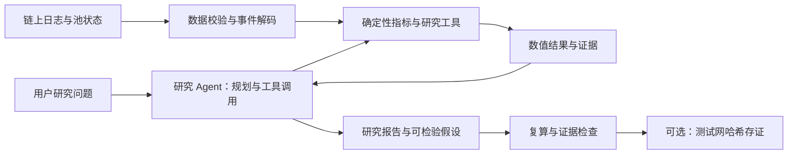

# Blockchain-Native AI Research Agent for On-Chain Crypto Quantitative Analysis

本项目面向 MSBD5017 的 Trade Topic 2：构建一个能够查询链上数据、计算量化指标、识别市场现象，并生成有证据支持的研究结论与策略假设的 AI research agent。

**当前状态：历史数据研究 MVP 已接通 GPT‑6.1 Sol，能调用本地指标工具、读取跨会话记忆，并生成带证据和数值核验的报告。默认通过本机 Codex CLI 的 ChatGPT 登录使用订阅账户；另保留 DeepSeek Harness + OpenAI API 入口。** 现有数据仅覆盖一个池的 10 天快照，尚未接入实时数据、训练预测模型或完成策略回测。采集器的已知问题见第 2.5 节。更新日期：2026-11-10。团队成员见 [proposal.md](proposal.md)。

## 0. 先运行当前 Agent

### 安装和账户

Python 3.10 或以上；本机已用 Python 3.13.3、Codex CLI 0.167.0 验证。新环境在项目根目录执行：

```bash
python3 -m venv .venv
.venv/bin/python -m pip install -r requirements.txt
codex login
.venv/bin/python -m onchain_agent doctor
```

需要已安装官方 [Codex CLI](https://learn.chatgpt.com/docs/cli)。`codex login` 使用 ChatGPT 账户登录；本机已经登录，可以直接运行下面的命令。默认入口复用 CLI 管理的登录状态，不要求 `.env` 的 API key，也不会读取或复制登录凭据。订阅使用仍受账户可用模型和额度限制。官方支持 [ChatGPT 订阅登录](https://learn.chatgpt.com/docs/auth) 和脚本调用 [codex exec](https://learn.chatgpt.com/docs/non-interactive-mode)。

```bash
# 默认演示：比较 10 月 4 日与 8 日的成交次数、规模和大额交易
.venv/bin/python -m onchain_agent run

# 自定义研究问题
.venv/bin/python -m onchain_agent run '2026-10-09 最大的三笔 Swap 是什么？给出交易证据，能否据此判断是机构交易？'

# 独立实验：不读取、也不写入之前的研究记忆
.venv/bin/python -m onchain_agent run --no-memory '2026-10-08 的成交量和 Swap 次数是多少？'
```

运行期间会等待模型调用完成，随后终端显示中文回答和报告目录。默认模型固定为 `gpt-6.1-sol`，推理档位 `medium`；可用 `--reasoning low` 或 `--reasoning high` 调整。单次模型运行超时为 300 秒，失败时返回非零退出码并保留已有诊断文件。

### 已接通的流程

```text
研究问题 → Codex CLI / GPT‑6.1 Sol → onchain-research skill
                                  ↕ MCP
                    指标查询 / 时段比较 / 单笔证据 / 研究记忆
                                  ↓
                       结构化报告 → 数值与引用核验
                                  ↓ 通过后
                       Markdown 报告 + SQLite 记忆
```

这里的 skill 规定研究步骤、指标口径和报告格式；实际计算由 Python 工具完成。默认入口的 agent 循环由 Codex 执行。切换到 `--backend harness` 时由 DeepSeek Harness 执行同一组 MCP 工具与 skill，不是把包月登录凭据转换为 API key。

| 工具 | 作用与边界 |
| --- | --- |
| `get_daily_metrics(day)` | 查询单个 UTC 日的审计指标、平均交易额、不同交易哈希数及证据 |
| `compare_periods(a_start, a_end, b_start, b_end)` | 比较两个左闭右开的 UTC 日期区间；变化量为 B−A；多日占比按总分子/总分母计算 |
| `get_large_trades(day, limit)` | 返回当天最大的 1–5 条 Swap，附交易哈希、日志索引、区块和快照引用 |
| `read_memory(query, limit)` | 读取固定研究口径和最多 10 条旧报告；旧数值必须用当前工具重新核对 |

每个数据进程启动时重新审计原始日志和保存的指标，查询时检查引用文件的 SHA-256。数据缺失会返回 `unavailable`，不使用模型记忆补数。研究记忆位于 `.dsh/state/research.sqlite3`，只由宿主程序在报告通过核验后写入；旧报告仍标注“解释未经人工审阅”。默认 Codex 运行关闭 shell、网页搜索和子 agent，挂载本项目的研究 MCP 工具。

每次运行写入 `reports/<UTC时间>-<运行ID>/`：

- `report.md`：可读研究报告与证据索引。
- `report.json`：正文、结构化数值 claims 和局限。
- `tool_results.jsonl`：本次真实工具调用参数、返回值和时间。
- `validation.json`：每条 claim 的精确值、单位、证据 ID 是否匹配本次工具结果。
- `run.json`：模型、认证方式、运行版本、代码/skill 哈希、状态与耗时；Codex 成功运行还保存 usage。
- `response.txt`：模型原始最终回答；Codex 入口另保存运行事件和 stderr 日志。

**核验范围：结构化数值与引用。** 校验器不保证正文每个数字都已列入 claims，也不自动判断解释、因果关系或投资结论正确性；这些仍需人工审阅。文件哈希不等于已完成独立链上真实性验证。密钥、运行状态、研究记忆与生成报告均已加入 `.gitignore`。

### 不调用模型的验证

```bash
.venv/bin/python -m onchain_agent query get_daily_metrics '{"day":"2026-10-08"}'
.venv/bin/python -m onchain_agent evaluate
.venv/bin/python -m unittest discover -s tests -v
```

固定题集在 [evaluation/cases.json](evaluation/cases.json)，包含 8 个参考案例及文字解释的人工评分要求。目前 8 个确定性工具案例和 13 项测试通过，测试包括真实 MCP 子进程通信、错误数值拒绝、无数据响应、记忆持久化和订阅进程的 API key 隔离。`evaluate` 检查工具输出，**不是 LLM 回答准确率实验**；无工具对照实验、完整模型题集评分仍待完成。

2026-11-10 已通过订阅账户完成三次真实 GPT‑6.1 Sol 研究调用：跨日期比较报告的 10 条结构化数值核验通过；第二次读取前次研究记忆、重新查询日指标并给出三笔交易证据；第三次请求未覆盖的 10 月 11 日，agent 调用工具确认缺失后说明无法给出成交量。成功样例保存在本机 `reports/`，生成目录不进入版本控制。

### 可选：DeepSeek Harness + API key

```bash
# 仅使用此入口时，在 .env 中配置 OPENAI_API_KEY
.venv/bin/python -m onchain_agent doctor --harness
.venv/bin/python -m onchain_agent run --backend harness
```

`.env.example` 提供配置模板。该入口使用 `openai-responses` 与 `gpt-6.1-sol`；当前已验证 Harness 启动和实际 API 请求，但提供的 API key 返回“没有剩余额度”，尚无此入口的成功模型报告。默认订阅入口已经成功，无需为运行本地演示改用 API 计费。两种入口分别使用 [OpenAI 官方说明的认证路径](https://learn.chatgpt.com/docs/auth)。

Harness 通过固定版本 `deepseek-harness-sdk==0.2.1rc2` 及其匹配的原生 runtime 启动，项目配置在 `.dsh/onchain.patch.yml`。`deepseek-harness/` 保留队友提供的独立源码 checkout（源码版本 0.2.2-rc.1），没有改动或构建；本次实际运行的是发布版 SDK，不是该源码构建产物。

### 当前下一步

先补齐链上来源核验和可靠的数据生产管线，再从小时级交易规模、方向、价格与流动性特征中选择一个研究假设，增加时序检验与策略回测。实时采集与训练任务应由确定性程序执行，skill 调用它们并解释结果。第 1–9 节保留项目审阅和后续研究设计；其中超出本节功能的模块仍是计划。

## 1. 现有 proposal 是否符合老师要求？

**基本符合，选题和范围合理，但“量化研究”这一主线需要加强。**

老师的要求包含：利用区块链生态数据，自动挖掘指标、识别市场规律，形成数据驱动的量化投资洞察和策略建议；分析过程可以进一步支持链上验证。单链、单协议、单池可以作为课程项目的合理收敛，并不需要一开始覆盖整个加密市场。

| 老师要求 | proposal 的覆盖情况 | 还需要补什么 |
| --- | --- | --- |
| 区块链原生数据 | 计划使用 Ethereum 上一个 Uniswap 池的 Swap 和流动性事件，方向正确 | 明确池地址、代币顺序、精度、时间范围、ABI 和采集方法 |
| 自动挖掘市场指标 | 提出交易量、交易次数、大额交易频率 | 补上可重复运行的数据管线和 agent 工具接口 |
| 识别市场规律 | 主要停留在查询和计算指标 | 增加跨时段比较、异常识别，以及交易方向、交易规模、流动性变化之间的分析 |
| 量化投资洞察 | 有可追溯报告，但主要研究问题是“工具能否提高 AI 回答准确率” | 明确一个市场研究问题，报告需要回答“这个现象说明什么、证据有多强” |
| 策略建议 | 缺少具体研究假设、规则和验证方案 | 至少完成一个可检验假设及一条条件式研究/风险管理规则，并报告历史检验结果 |
| 透明与可验证 | 数据快照、计算方法、证据、测试网哈希存证，设计合理 | 补源码、配置、数据清单和复现命令；区分文件完整性、数据真实性和结论正确性 |
| 实验评估 | 已计划数值准确性、可追溯性、无依据结论和生成时间 | 同时评估量化研究结果，并明确公平基线、参考答案和分层题集 |

建议把研究问题分成两个层次：

1. **业务主问题：** 基于单个 Uniswap 池的交易规模、交易方向和流动性变化，agent 能否识别有证据支持的市场状态，并提出、检验可复现的量化研究或风险管理假设？
2. **系统评估问题：** 在同等信息条件下，数据查询与确定性计算工具是否提高 agent 报告的数值准确性、证据覆盖率和可复现性？这种提升是否随问题复杂度变化？

原 proposal 的系统评估设计可以保留。需要补充的是“具体研究什么市场现象，以及研究结果如何转化为可检验的策略假设”。老师原文中的链上验证是可选扩展；proposal 已承诺测试网演示，建议安排在数据、研究与 agent 主流程完成之后。本次保留原 proposal，修改建议集中在这里，方便团队讨论后更新正式版本。

## 2. 文件夹与现有材料

数据目录已更名为英文，原始日志和队友提供的指标文件内容保持不变：

| 原目录 | 当前目录 | 用途 |
| --- | --- | --- |
| `数据/` | `data/` | 数据及核对结果 |
| `数据/原始数据/` | `data/raw/` | 原始事件日志和抓取状态 |
| `数据/计算结果/` | `data/processed/` | 队友生成的每日指标 JSON 和汇总 CSV |

```text
trade_agent/
├── .gitignore
├── proposal.md
├── README.md
├── requirements.txt                     # 固定 Python 直接依赖
├── .env.example                         # 可选 API 入口的配置模板
├── .dsh/
│   ├── onchain.patch.yml                 # DeepSeek Harness + Responses API 配置
│   ├── research-instructions.md          # Codex 研究 agent 的系统指令
│   ├── skills/onchain-research/SKILL.md   # 共用研究 skill
│   └── state/                           # 运行时和记忆，Git 忽略
├── onchain_agent/                        # CLI、数据工具、MCP、两种模型入口、报告核验
├── evaluation/cases.json                 # 固定问题、工具参考值与解释评分要求
├── tests/                               # 工具、报告、记忆、运行入口和 MCP 测试
├── reports/                             # 每次运行的报告与证据，Git 忽略
├── deepseek-harness/                     # 独立 Git checkout：保留的上游源码
├── fetch_events_shareable.py             # 队友补充：按 UTC 日期抓取池事件
├── scripts/
│   └── audit_data.py                     # 离线复核脚本
└── data/
    ├── raw/
    │   ├── events_2026-10-01.ndjson       # 每行一条池合约事件，至 10-10
    │   └── fetch_status_2026-10-01.json   # 每日抓取状态，至 10-10
    └── processed/
        ├── metrics_2026-10-01.json       # 每日统计与最大交易证据，至 10-10
        └── daily_metrics_2026-10-01_to_10.csv
```

`processed` 是统计结果，不是已经训练好的模型、交易信号或策略回测。[fetch_events_shareable.py](fetch_events_shareable.py) 提供原始日志的采集逻辑；仍没有生成现有每日 JSON/CSV 的原指标计算源码或智能合约代码。新增 agent 和固定题集见第 0 节。[onchain_agent/data_tools.py](onchain_agent/data_tools.py) 基于 `audit_data.py` 重算并核对当前快照，再提供研究查询；这仍不能替代通用的指标生产管线。

目录清理时删除了系统缓存 `.DS_Store`、可重新生成的 `data/audit_report.json`，并将旧下载说明合并至第 2.5 节。原始日志、抓取状态、指标 JSON/CSV 和采集/审计代码仍用于复现、联调和参考答案核对；`deepseek-harness/` 保留完整源码。审计报告按需生成，相关生成文件及 Python 缓存已加入 Git 忽略规则。

### 2.1 原始数据是什么？

- 范围：`2026-10-01 00:00:00` 至 `2026-10-11 00:00:00`，左闭右开，全部按 **UTC** 切日。北京时间查看时需注意 8 小时时差。
- 池地址：`0x88e6a0c2ddd26feeb64f039a2c41296fcb3f5640`。
- 抓取状态中声明的来源：`Alchemy Ethereum Mainnet`；新增脚本通过 `ALCHEMY_RPC_URL` 读取端点并限制其为 Alchemy Ethereum Mainnet HTTPS URL。本次未独立向 RPC 核验，也未执行真实采集。
- 现有指标将 `token0` 按 USDC、6 位小数处理；后续必须保存合约查询得到的 `chain_id`、`token0`、`token1`、`decimals` 和 `fee` 等元数据，确认拟研究的 USDC/WETH 池配置。
- `events_*.ndjson` 是合约事件日志，不是完整交易明细。主要字段包括 `address`、`topics`、`data`、`blockNumber`、`blockHash`、`blockTimestamp`、`transactionHash`、`transactionIndex`、`logIndex`、`removed`。
- `topics` 和 `data` 仍是 ABI 编码，需要解码；十六进制区块号、时间戳也需要转换。日志没有直接给出 gas 成本、用户身份或交易动机。

`fetch_status_*.json` 保存了日期、池地址、RPC 提供者、完成标记、分块数、事件数、字节数和请求区块范围。它可以辅助检查采集进度，但 `complete: true` 本身不能证明没有漏抓。

### 2.2 “计算结果”具体算了什么？

| 字段 | 含义与口径 |
| --- | --- |
| `event_count` | 当天这个池的日志总条数 |
| `swap_count` | Swap 事件条数；不等于独立交易笔数，也不等于用户数 |
| `mint_count` / `burn_count` | 增加/减少头寸流动性的事件条数；次数差不是流动性金额净变化 |
| `other_event_count` | 非 Swap、Mint、Burn 的日志数；目前未细分解释 |
| `usdc_volume` | `sum(abs(Swap.amount0_raw)) / 10^6`，每次 Swap 只统计 USDC 一侧 |
| `large_trade_threshold_usdc` | 当前为 100,000 USDC；审计按单笔金额 `>=` 阈值计算 |
| `large_trade_count` | 达到上述阈值的 Swap 数量 |
| `large_trade_frequency` | `large_trade_count / swap_count`，保存的是比例，展示为百分比要乘 100 |
| `largest_swap_evidence` | 当日金额最大的 5 条 Swap，带金额、交易哈希、日志索引和区块号 |
| `snapshot_sha256` | 对对应原始 NDJSON 文件完整字节计算的 SHA-256 |
| `first_block` / `last_block` | 记录的采集请求边界；不一定恰好等于首尾事件所在区块 |

金额先按有符号 `int256` 解码，再做精度转换。交易量与方向必须分开计算：取绝对值适合统计交易量，但会丢失买卖方向。USDC 计价也不自动等同于独立美元价格数据。

### 2.3 本次核对结果

从全部原始日志重新读取、解码并计算，得到：

| 项目 | 结果 |
| --- | ---: |
| 日期数 | 10 |
| 事件总数 | 75,009 |
| Swap 事件 | 73,017 |
| 包含该池 Swap 的不同交易哈希数 | 71,969 |
| Mint / Burn / 其他事件 | 454 / 777 / 761 |
| USDC 单侧累计交易量 | 351,646,031.648513 USDC |
| 至少 100,000 USDC 的 Swap | 375 |

10 天的原始文件哈希、事件分类计数、USDC 交易量、大额交易次数与比例、最大交易证据，以及 CSV 与 JSON 的一致性检查均通过。未发现重复的池地址/交易哈希/日志索引组合，所有日志的 `removed` 都为 `false`；记录的时间戳属于文件标示的 UTC 日期，采集请求的区块区间连续。

两处细节需要保留在复现说明中：

1. 当前原始文件使用 CRLF 换行，而 `fetch_status.bytes` 恰好等于转为 LF 后的文件大小。新增爬虫在文本模式写入 `\n`，同时按转换前字符串的 UTF-8 字节计数，这与 Windows 文本换行转换造成的大小差异一致。现有 `snapshot_sha256` 匹配的是当前原文件字节。不要为了格式统一改写原始日志，否则哈希会变化。
2. 10 月 9 日最大交易中有 3 条同为 250,000 USDC，保存结果与按区块排序的结果存在同额排序差异，证据和金额均正确。后续应固定排序规则，例如“金额降序、区块号升序、日志索引升序”。

**本次证明的是本地文件之间的一致性。** 尚未独立验证主网来源、区块哈希、时间戳和日志完整性，也未验证完整代币元数据。全量统计不能替代向独立 RPC 抽查交易回执、核对日期边界区块和重放采集请求。

### 2.4 如何重跑核对？

需要 Python 3.9 或以上，无第三方依赖。在项目根目录执行：

```bash
python3 scripts/audit_data.py
```

审计报告不作为必需输入保留。如需生成机器可读报告：

```bash
python3 scripts/audit_data.py --output data/audit_report.json
```

脚本只读取队友提供的原始数据与统计文件；指定 `--output` 时写入核对报告。检查通过时退出码为 0，发现不一致时返回非零退出码。该脚本针对当前这批文件及其 CSV 命名，不是已经完成的数据采集和指标生产管线。

### 2.5 新增采集代码的审阅结论

这份代码是 **JSON-RPC 事件采集器**：使用 Python 标准库访问 Alchemy，二分查询 UTC 日期的开始/结束区块，再通过 `eth_getLogs` 抓取指定池地址的全部事件。查询没有设置 `topics` 过滤，所以会保留 Swap、Mint、Burn 以外的事件；它没有执行 ABI 解码、指标计算、哈希生成或 AI 分析。

已具备的功能包括：

- 接受一个日期参数，默认为 `2026-10-01`；池地址固定在代码中。
- 默认每批 20 个区块，部分 HTTP 错误后缩小批次；连接类异常最多尝试 5 次。
- 写入每日 NDJSON 和抓取状态；在状态与文件匹配时从 `last_completed_block + 1` 续传。
- 设置 30,000 条日志、20 MiB 和单次运行 1,000 批的停止条件；这些条件在批次写入后检查，实际日志数和大小可能超过阈值。达到单次批次上限可按续传逻辑再次运行；达到日志数或大小上限需调整采集方案。
- 使用环境变量读取 RPC 地址，提供的源码没有内置 API key。

现有 10 个快照在将 CRLF 规范化为 LF 后，全部符合脚本的 JSON 序列化方式；日期、池地址、输出字段和进度结构也相符。这支持它与已有采集流程一致，但还不能证明当前代码版本就是当时实际运行的版本，仍需版本记录和链上来源核验。

**已用临时目录与模拟 RPC 复现的问题：**

| 优先级 | 问题与触发条件 | 后果 | 建议处理 |
| --- | --- | --- | --- |
| 高 | `data_file` 已存在但进度文件缺失，代码仍选择 `mode='w'` | 原始快照被覆盖 | 任何既有文件都先校验；缺少配套状态时停止，恢复或重抓必须使用明确流程 |
| 高 | 缺少 RPC 配置、请求失败等发生在读取原进度之前，异常处理仍写回新建的 `status` | 原有完成标记、日志数和断点被覆盖 | 启动校验与运行状态分离；未进入有效采集时保留原状态；状态使用临时文件加原子替换 |
| 高 | 请求未来日期或尚未结束的 UTC 当天，没有验证链头时间是否覆盖 `END` | 空区间或不足一天的数据被标为 `complete: true` | 检查结束边界是否可取得；未结束窗口拒绝处理或明确标为 partial；按需基于 finalized 区块限定范围 |
| 高 | 原始日志已刷新到文件，但对应进度还未成功保存时进程中断 | 续传重复追加同一批日志，文件行数和状态计数不一致 | 保存已提交文件偏移/批次清单，恢复前核对并处理未提交尾部；增加去重和一致性校验 |
| 中 | 捕获异常后只打印 `STOP`，主程序没有返回非零退出码 | 缺配置、抓取失败都可能被调度程序视为成功 | 为成功、未完成和失败设计明确退出码；下游同时校验完成状态和文件内容 |

复现中，续传问题出现了“文件实际 3 条日志、进度只记录 2 条、仍标记完成”；未来日期出现了 `first_block=10, last_block=9, complete=true`。正常且已结束的历史日期边界测试通过。测试未访问真实 RPC、未使用实际 API key、未改写已有快照，也未修改这份采集源码；这些问题不代表已提供的 10 天数据必然受影响。

其他应改进项：JSON-RPC 响应中的 `error` 会直接引发 `RuntimeError`，不进入连接重试或缩小区块批次的分支；`complete: true` 的已有文件没有进一步做计数、范围和哈希校验；没有保存链 ID、代币元数据、采集代码版本、边界区块哈希或最终性信息。

**采集使用说明（由旧下载说明合并）：** 每位组员使用自己的 Alchemy Ethereum Mainnet 应用，在运行脚本的同一终端通过 `ALCHEMY_RPC_URL` 环境变量提供 HTTPS Endpoint，不将密钥写入项目文件。macOS/zsh 使用 `export ALCHEMY_RPC_URL='你的 Endpoint'`，Windows/PowerShell 使用 `$env:ALCHEMY_RPC_URL = '你的 Endpoint'`。当前调用形式为 `python3 fetch_events_shareable.py YYYY-MM-DD`（Windows 可使用 `python`），默认日期为 `2026-10-01`。输出固定在脚本所在目录，本项目中即根目录，尚未接入 `data/raw/`。

组员应分配不同日期，汇总前核对完成状态、事件行数及重复日志。鉴于上述已复现问题，完成标记还需与实际文件校验结合；未完成数据不能用于全天指标。修复文件保护问题后，建议增加 `--output-dir` 等参数；不要为了迁移路径直接对已有快照重跑当前脚本。

## 3. Agent 最终应该实现什么？

用户提出一个有池地址和时间范围的研究问题后，agent 应当能够：

1. **明确问题和数据范围**：确定需要哪些指标、时间粒度与历史窗口；先检查数据是否足够。
2. **调用工具取得事实**：查询结构化事件和池状态，用代码计算金额、比例、价格、流动性相关指标。
3. **进行研究分析**：比较时段、识别异常，判断观察到的变化属于交易频率、交易规模、方向或流动性层面的变化。
4. **提出并检验假设**：把“可能存在关系”转化为可重复执行的规则或统计检验；区分已测量事实、相关性和未验证解释。
5. **生成有证据的报告**：给出结论、数值、定义、证据、局限，以及基于结果的条件式研究建议。
6. **支持复现与复核**：保存输入快照、工具调用、计算配置和输出；能够定位原始日志并重算关键数字。

建议第一版采用 **一个负责规划和调用工具的 agent，加一组确定性 Python 工具**。数据采集、指标计算、研究分析、证据校验是功能模块，不要求每个模块都使用一个独立 LLM agent。先证明任务闭环有效，再决定是否需要多 agent 协作。



## 4. Agent 应该回答哪些问题？

以下区分已经接入 agent 的日级研究工具与后续研究范围；完整运行说明见第 0 节。

| 层级 | 示例问题 | 需要的分析 | 当前支持情况 |
| --- | --- | --- | --- |
| 直接查询 | 10 月 8 日成交量和 Swap 次数是多少？ | 查指标并附日期、池和单位 | 已接入 `get_daily_metrics` |
| 直接查询 | 10 月 9 日最大几笔 Swap 是什么？ | 金额排序、同额处理、定位日志 | 已接入 `get_large_trades` |
| 派生计算 | 10 月 8 日比 10 月 7 日成交量增加多少？ | 差额、增长率、分母检查 | 已接入 `compare_periods` |
| 派生计算 | 交易次数最多的一天，成交量也是最大的吗？ | 跨日排序、平均交易规模比较 | 可逐日查询；尚无专用全窗口排序工具 |
| 派生计算 | 大额交易贡献了多少成交量？ | 大额交易金额占比，而非只看次数占比 | 原始数据可计算，现有汇总没有 |
| 市场结构 | 哪些小时是高频小额成交，哪些是大额成交主导？ | 小时聚合、规模分布、历史基准 | 原始数据可支持，尚未实现 |
| 交易方向 | 某时段交易者净买入还是净卖出 WETH？ | 确认代币顺序，保留 amount0/amount1 符号，计算方向性不平衡 | 需解码和元数据确认 |
| 流动性行为 | 大额 Swap 附近是否出现活跃流动性变化或头寸撤出？ | Swap/Mint/Burn 时序、金额和价格区间 | 现有日志有部分基础，需进一步处理 |
| 多步研究 | 大额成交占比上升后，下一小时波动是否更高？ | 明确假设、对照窗口、未来收益/波动标签和统计不确定性 | 需指标管线与更长时间窗口 |
| 策略研究 | 这类现象能否支持一个风险预警或仓位过滤规则？ | 给出触发/失效条件，历史检验并说明适用边界 | 尚未实现 |
| 证据审查 | “巨鲸入场导致上涨”是否被这些数据支持？ | 核验事实与推断边界，指出身份和因果证据缺失 | 应作为必测的越界问题 |

### 一个可直接用于演示的问题

> 为什么 2026-10-04 的 Swap 次数比 2026-10-08 多，但交易量更低？这些数据能支持什么结论？

下表来自本地日志复算；平均金额保留两位小数、频率保留四位百分比小数：

| UTC 日期 | Swap 次数 | USDC 交易量 | 平均每次 Swap 金额 | 大额交易次数占比 |
| --- | ---: | ---: | ---: | ---: |
| 2026-10-04 | 13,946 | 18,264,812.208486 | 1,309.68 USDC | 0.1219% |
| 2026-10-08 | 8,938 | 77,325,273.742395 | 8,651.29 USDC | 1.1524% |

合格回答应解释：10 月 4 日 Swap 更多，但单次平均金额更低；10 月 8 日金额更大、大额 Swap 更常见。这支持“这两个样本日的成交规模结构不同”。后续可以研究这种差异与交易方向、波动和流动性的关系。

这些数字不能单独证明“散户入场”“机构吸筹”“机器人刷量”或“随后一定上涨”。本例解释的是统计上的构成差异，没有识别造成差异的外部原因。

## 5. 还要补哪些数据和指标？

### 5.1 优先完善数据基础

1. **完善已有采集器并补齐指标源码**：采集脚本已提供，先修复第 2.5 节的文件保护、日期边界、异常续传及退出码问题，统一输出目录和运行说明；继续找回生成每日 JSON/CSV 的原计算代码，或独立实现并核对结果。保存依赖、采集时间、代码版本、RPC 分块与重试配置和过滤条件。凭据继续用环境变量管理，复现清单不记录 API key。
2. **保存池元数据与 ABI**：链 ID、池地址、token0/token1 地址及精度、费率、ABI/代码版本与查询区块。
3. **生成解码表**：至少包含时间、区块号、交易哈希、日志索引、事件类型、代币原始整数金额、标准单位金额，以及 Swap 的价格与流动性字段；保留到原日志的映射。
4. **补来源与完整性验证**：核对日期边界、抽查区块和回执；无事件的区块不应被误判为漏抓。RPC 日志和区块查询可参考 [Ethereum JSON-RPC 文档](https://ethereum.org/developers/docs/apis/json-rpc/)。
5. **延长历史窗口**：当前 10 天先用于联调和案例展示；课程研究可先以连续 60–90 天作为采集预算，再根据有效样本和市场状态覆盖评估是否足够。这个长度是工程建议，不保证统计结论成立。
6. **按需要补状态和执行成本**：若要做精确深度、滑点或收益回测，需要历史池状态、相关 ticks、交易回执中的 gas 使用与费用等；不能从现有每日统计直接得到这些量。

### 5.2 最小可用指标集合

| 类别 | 第一版指标 | 作用与边界 |
| --- | --- | --- |
| 活跃度 | 交易量、Swap 数、独立交易数、平均/中位交易额 | 分清“交易更多”和“金额更大” |
| 规模分布 | 大额交易次数占比、金额占比、金额分位数、最大交易 | 不把大额交易直接解释为某类投资者行为 |
| 交易方向 | 买入/卖出 WETH 的 USDC 成交量、方向性不平衡 | 限定为该池内的成交方向，不代表全市场资本净流入 |
| 价格与波动 | 池内价格、固定频率收益、下一窗口波动 | 区分池内价格和外部市场价格，避免未来信息泄漏 |
| 流动性行为 | 活跃流动性样本、Mint/Burn 金额与区间、事件附近变化 | 先给可支持的事件级观察，再决定是否重建完整状态 |
| 异常与状态 | 相对过去窗口的成交量、规模和波动异常 | 阈值在训练/历史窗口确定，明确样本和缺失数据处理 |

关键计算口径：

- 大额**次数**占比为 `N_large / N_swap`；大额**金额**占比为 `sum(volume_large) / sum(volume_all)`，两者回答不同问题。
- 在确认 token0=USDC、token1=WETH 后，`amount0 > 0, amount1 < 0` 表示池收到 USDC、付出 WETH，对应交易者买入 WETH；反向则是卖出。可定义 `imbalance = (buy_usdc - sell_usdc) / (buy_usdc + sell_usdc)`，分母为 0 时返回空值。
- Swap 的 `sqrtPriceX96` 是交易后池内价格编码，`amount0/amount1` 是池余额变化。解码应依据 [Uniswap v3 官方事件接口](https://raw.githubusercontent.com/Uniswap/v3-core/main/contracts/interfaces/pool/IUniswapV3PoolEvents.sol)，不能让 LLM 猜字段含义。
- 设 `d0`、`d1` 为代币精度，则 `token1_per_token0 = (sqrtPriceX96 / 2^96)^2 × 10^(d0-d1)`；若要 USDC/WETH 报价，需要在确认代币顺序后取正确方向。价格和活跃流动性的定义见 [官方池状态接口](https://raw.githubusercontent.com/Uniswap/v3-core/main/contracts/interfaces/pool/IUniswapV3PoolState.sol)。
- Uniswap v3 活跃流动性 `L` 不是 TVL，也不是可直接用美元表示的深度；跨 tick、价格移动和 Mint/Burn 都可能影响观测。不能把 `mint_count - burn_count` 当作资金净流入。Burn 和实际领取代币也需区分；余额核算要结合 Collect 等事件或链上状态。
- 记录 Swap 后状态只能描述采样点。要得到严格小时末状态，需处理样本后的相关事件或查询边界状态；不能将“小时内最后一笔 Swap 的状态”无说明地当作完整小时末状态。

## 6. 量化研究与策略假设怎么落地？

建议只选 **一个主要假设**，把定义、证据和验证做完整。例如：

> H1：当某小时的大额成交金额占比和方向性不平衡绝对值同时较高时，下一小时的池内价格波动是否高于其他时段？

这里的“较高”可以定义为超过训练期对应指标的预设分位数。具体阈值必须写入配置，不能观察测试结果后反复修改再报告最好的一组。

建议的最小研究流程：

1. 按 UTC 小时构造特征；用固定 5 分钟价格序列计算下一小时的实现波动，例如 `sqrt(sum(log(P_k / P_(k-1))^2))`，明确边界价格、无交易区间填充方式和是否年化。
2. 按时间划分训练、验证、测试区间；在边界剔除标签跨区间的样本。训练期选阈值，验证期确定方案，测试期只评估冻结后的方案。
3. 与无条件基线、仅交易量阈值的简单基线比较，报告样本数、波动差异、效果大小及不确定性；时间序列存在相关性，不能把每笔 Swap 当作独立研究样本。
4. 形成一条可解释的风险预警规则，例如“满足条件时提高下一小时波动风险等级”；检验误报率、覆盖率和跨时段稳定性。只有结果支持时，才把它写成后续仓位风险控制的研究建议。
5. 若进一步展示投资策略收益，明确仓位、触发、退出、成交时间和基准（如持有 WETH）；信号必须在小时结束后可知，下一可执行时点才成交，并纳入手续费、gas、滑点、换手率和最大回撤。缺少执行数据时只能标为简化模拟。

10 天有大量事件，但只有 10 个日样本、最多 240 个小时窗口，不能把交易笔数当作独立策略样本数。当前数据适合打通流程和探索现象；长期规律、可迁移性和收益能力仍需验证。假设未获支持也是有效研究结果，应保留，不应强行生成买卖结论。

## 7. 系统需要实现哪些模块？

下表是完整项目目标。第 0 节已实现基础日指标、时段比较、研究 agent、结构化数值校验和固定工具测试；研究假设检验、回测、完整对照评测和链上存证仍待实现。表中的概念接口名不一定等于当前 MCP 工具名：

| 模块 | 主要职责 | 验收产物 |
| --- | --- | --- |
| 数据采集与校验 | 抓取/读取日志与状态，检查范围、去重、保存元数据 | 可复跑采集命令、数据清单、质量报告 |
| ABI 解码与存储 | 转换事件字段，保持精确整数和日志引用 | 可查询的事件表及字段字典 |
| 指标工具 | `compute_metrics`、`compare_periods`、`get_evidence` | 可重复的指标 JSON、明确单位和口径 |
| 研究工具 | `detect_anomalies`、`test_hypothesis`，需要时增加回测工具 | 状态标签、检验表、研究图表 |
| 研究 agent | 理解问题、选择工具、读取结果、组织报告 | 可运行 CLI 或简单界面、工具调用轨迹 |
| 证据与报告校验 | 检查引用、单位、数值、时间范围及 unsupported claims | 报告 JSON + 可读报告、校验结果 |
| 评测与复现 | 固定题集、对照实验、独立参考答案、重跑记录 | 按难度分层的评测报告 |
| 存证演示 | 对数据、计算配置和报告生成清单并记录哈希 | 可验证清单、测试网交易与核验命令 |

工具返回值建议统一包含 `status`、`value`、`unit`、`period_utc`、`definition`、`parameters`、`source_refs`、`warnings`。缺数据、零分母或超出覆盖范围时返回明确状态；agent 根据工具结果说明限制。

LLM 负责问题理解、研究规划与解释；金额、排序、收益、统计检验和哈希交给代码。完整报告建议固定为：**结论 → 关键指标 → 证据与方法 → 假设/解释 → 策略研究建议 → 局限和下一步**。

## 8. 怎样验证 agent 真正有用？

### 8.1 研究质量与回答质量分别评估

| 维度 | 建议衡量方式 |
| --- | --- |
| 量化研究 | 假设是否明确；基线、时间划分和费用假设是否合理；结果是否包含不确定性与失败案例 |
| 数值正确性 | 逐条核对关键数值；计数精确匹配，金额按单位精度或声明的展示舍入规则匹配 |
| 证据覆盖 | 可验证事实中，具备可访问且足以支持该事实的证据的比例 |
| 无依据断言 | 把相关性说成因果、虚构资金身份、超出数据范围等断言的数量/比例 |
| 可复现性 | 固定数据、代码版本和配置后，工具数值与证据能否重算一致；不要求随机生成的文字逐字相同 |
| 效率 | 端到端耗时、工具调用次数、token 使用和成本 |

注意：一条交易哈希可以支持“这一笔 Swap 的金额”，但不能独自支持“全天成交量”。聚合结论需要快照哈希、时间/事件筛选条件、计算定义和代码版本；必要时提供事件索引清单。

### 8.2 公平的对照实验

- 基线 A：同一个模型，无计算工具，读取受控的解码输入表。
- 实验 B：同一个模型、同样问题和同样源数据，允许调用查询与计算工具。
- 可选基线 C：固定统计脚本加报告模板，用来判断 agent 在灵活提问和解释方面是否有额外价值。

固定模型版本、提示词、采样设置和输入范围，记录运行次数与失败情况。不要给某组更完整的数据，也不要把待求答案预先塞进某一组输入。

完整原始日志约 67 MB，不适合直接塞进模型上下文。受控实验可为每道题构造双方一致、能放入上下文且未预给目标答案的解码子集；全量数据的端到端能力另行评估，并明确与受控实验的区别。

建议先建立 30 道题：直接查询、派生计算、多步研究各 10 道，再增加缺数据、零分母、同额排序、单位混淆和过度因果解释的边界题。参考数值由独立计算或人工抽查确认；不能直接把 agent 自己的计算结果当作唯一参考答案。多步推断题按事实、证据和不确定性分别评分。

### 8.3 “链上验证”具体证明什么？

最小演示可以把原始数据哈希、指标配置/代码版本、报告哈希组织成一个确定性序列化的 manifest，再把 manifest 的哈希提交到 Ethereum 测试网。保存链 ID、合约地址、交易哈希和序列化方法，并提供本地重算后与链上记录比对的命令。

哈希存证能帮助检测存证后文件被修改，不能证明原始数据真实完整，也不能证明分析或策略正确。若只存哈希，实际计算仍在链下；要验证计算过程，还需取得数据、代码和配置并重算。第一版无需实现 ZK 证明或把研究计算全部搬上链。

## 9. 实施顺序与完成标准

当前已先完成 P2 中基于固定快照的基础 agent 闭环和部分 P3 工具参考测试；这不代表 P0 数据来源问题或 P1/P3 的市场研究检验已经完成。

| 优先级 | 要完成的工作 | 结束条件 |
| --- | --- | --- |
| P0：数据基础 | 修复已有采集器，补齐指标计算源码、确认元数据、完成解码与来源抽查、固定指标定义 | 中断重启不丢失或重复数据；从原始快照可一键重建已有指标，差异可解释 |
| P1：研究原型 | 补小时指标、规模分布、交易方向、基础流动性观察；冻结一个主要假设 | 有一份带真实计算结果、证据和局限的研究报告 |
| P2：Agent 闭环 | 接入数据/计算/研究/证据工具，支持第 4 节问题类型 | 能从自然语言问题生成可核验报告，并正确处理缺数据 |
| P3：研究与系统评测 | 扩展历史窗口，完成时间外检验、题集与公平对照实验 | 有基线、有失败案例、有数值和研究质量评测 |
| P4：透明性演示 | 完成 manifest、复现命令和测试网存证演示 | 第三方能校验文件与链上记录并重算关键指标 |

团队可按“数据与指标”“研究与历史检验”“agent、评测与证据”三个工作包分工。每个工作包先约定字段与输入输出；最终交叉复核参考答案和数据口径，避免各自使用不同定义。

最终提交应至少包括：可运行的研究 agent、可复现的数据和指标流程、一组明确的研究问题、一项已检验的市场假设及其条件式策略/风险规则、带证据的样例报告、对照评测，以及 proposal 所承诺的存证演示。实时交易、多链覆盖、训练大模型和复杂预测模型不属于首版范围。
